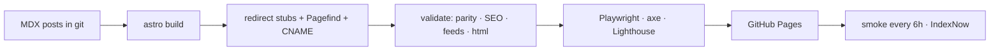

# serverless.fyi — 2 Minute Serverless

[](https://github.com/mohnishbasha/serverless-fyi/actions/workflows/ci.yml)
[](https://github.com/mohnishbasha/serverless-fyi/actions/workflows/deploy.yml)
[](https://github.com/mohnishbasha/serverless-fyi/actions/workflows/smoke.yml)

_Freshly baked serverless nuggets in 2 minutes._ Data, AI, distributed systems and startups, by Mohinish Shaikh.

This repository is the source of **<https://www.serverless.fyi>**. It's a static [Astro](https://astro.build) site, built by GitHub Actions and hosted on GitHub Pages. Every post is a Markdown/MDX file in git. The site was migrated from Beehiiv with every legacy URL preserved.

- **Fast and accessible:** Lighthouse mobile scores 100 across the board, axe reports 0 violations, and pages ship no framework JS.
- **Responsive and calm:** a serene mint/sage/sky theme (system fonts, no Tailwind) that works from 320px to 1440px+ with no horizontal overflow and 44px tap targets.
- **Agent-ready:** [`/llms.txt`](https://www.serverless.fyi/llms.txt), [`/llms-full.txt`](https://www.serverless.fyi/llms-full.txt), a Markdown twin at `/p/<slug>.md`, [`/api/posts.json`](https://www.serverless.fyi/api/posts.json), and RSS, Atom and JSON feeds, all listed on [`/feeds/`](https://www.serverless.fyi/feeds/) (linked as **RSS** in the menu).
- **SEO:** a JSON-LD graph on every page, OG images built at deploy time, a sitemap with `lastmod`, and IndexNow pings.

## Quickstart

```bash
corepack enable            # uses the pnpm version pinned in package.json
pnpm install
pnpm dev                   # http://localhost:4321
pnpm check                 # lint + typecheck + unit + build + validate
```

Requires Node 24 LTS (`.nvmrc`).

| Command                                   | What it does                                                      |
| ----------------------------------------- | ----------------------------------------------------------------- |
| `pnpm build`                              | Static build to `dist/` (plus redirect stubs and a search index)  |
| `pnpm validate`                           | Content guard, URL parity, SEO, feeds, dist sanity, html-validate |
| `pnpm test:unit`                          | Vitest                                                            |
| `pnpm test:e2e`                           | Playwright (4 viewports + no-JS, axe, visual on Linux)            |
| `pnpm lhci`                               | Lighthouse CI on 4 templates                                      |
| `node scripts/serve-dist.mjs 4399`        | Serve `dist/` the way GitHub Pages does                           |
| `bash scripts/smoke.sh <url>`             | Live smoke checks                                                 |
| `bash scripts/update-snapshots.sh`        | Regenerate visual snapshots in Docker (Linux)                     |
| `pnpm migrate:scrape` / `migrate:convert` | Re-run the Beehiiv import (see `docs/CONTENT_MIGRATION.md`)       |

To build the staging site:

```bash
SITE_URL=https://mohnishbasha.github.io BASE_PATH=/serverless-fyi/ PUBLIC_INDEXABLE=false pnpm build
```

## Publish a post in 5 steps

1. `git checkout -b content/<slug>` and run `pnpm new-post "Your title"`.
2. Write the post in `src/content/posts/<slug>/index.mdx`: answer first, about 400–600 words, following [docs/STYLE_GUIDE.md](docs/STYLE_GUIDE.md).
3. Fill in `description`, `tldr`, `keyTakeaways`, tags, and a cover with `coverAlt`. Replace every `TODO(owner)` and set `draft: false`.
4. Run `pnpm check`, then preview the `.md` twin at `/p/<slug>.md`.
5. Open a PR titled `content(post): <title>`. When it merges, the post is live in under 5 minutes, with feeds, sitemap and IndexNow updated.

## Architecture



Full details are in [docs/ARCHITECTURE.md](docs/ARCHITECTURE.md). Requirements are in [docs/PRD.md](docs/PRD.md), and decisions in [docs/DECISIONS.md](docs/DECISIONS.md). Operations are covered in [docs/RUNBOOK.md](docs/RUNBOOK.md). Email is sent with Kit's free plan (`PUBLIC_NEWSLETTER_PROVIDER=kit`, [ADR-028](docs/DECISIONS.md)). The self-hosted stack (listmonk + Amazon SES) in [infra/newsletter/](infra/newsletter/README.md) is the planned migration target before ~10,000 subscribers.

## Harnesses

Agent instructions live in [AGENTS.md](AGENTS.md); `AGENT.md` is a symlink to it. The voice and values are in [SOUL.md](SOUL.md), and the skill index is in [SKILLS.md](SKILLS.md).

- **Claude Code** reads [CLAUDE.md](CLAUDE.md), `.claude/commands` (`/new-post`, `/migrate`, `/audit-seo`, `/ship`, `/fix-ci`), `.claude/agents` and `.claude/skills`.
- **GitHub Copilot** reads `.github/copilot-instructions.md`.
- **Cursor** reads `.cursor/rules/project.mdc`.
- **Goose, OpenCode and Pi** read `AGENTS.md` natively. Point them at `.agent/skills/` for the harness-agnostic skills (run-tests, check-types, new-post, verify-deploy).

No MCP server is needed. The agent-facing surface is `llms.txt`, the Markdown twins, `api/posts.json` and the feeds.

## License

The code is under the [MIT license](LICENSE). Post content and brand assets are © Serverless Ventures LLC; see [CONTENT_LICENSE.md](CONTENT_LICENSE.md). Third-party licenses are listed in [THIRD_PARTY_LICENSES.md](THIRD_PARTY_LICENSES.md).
