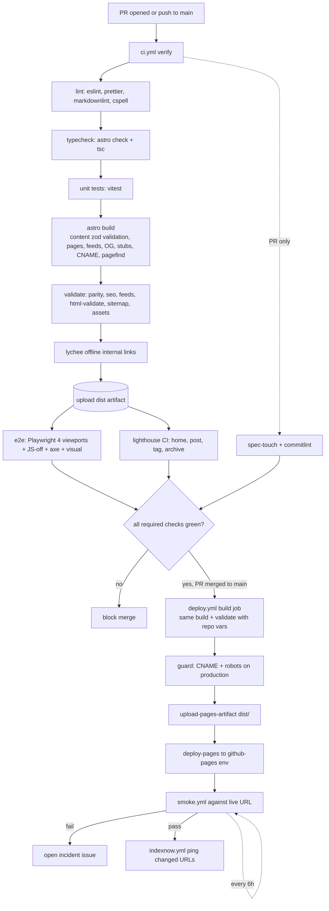

# ARCHITECTURE — serverless.fyi

Companion to `docs/PRD.md`. If they disagree, update both in the same PR.

## 1. Overview

A fully static site. Content is Markdown/MDX in git. Astro builds HTML, feeds, OG images and agent endpoints into `dist/`. Pagefind indexes `dist/` after the build. GitHub Actions validates and deploys `dist/` to GitHub Pages. There is no server-side code. Email delivery is handled by an external provider chosen at build time (Beehiiv interim, then listmonk + SES).

Hosts:

| Environment | URL                                              | `SITE_URL`                       | `BASE_PATH`        | `PUBLIC_INDEXABLE` |
| ----------- | ------------------------------------------------ | -------------------------------- | ------------------ | ------------------ |
| Staging     | `https://mohnishbasha.github.io/serverless-fyi/` | `https://mohnishbasha.github.io` | `/serverless-fyi/` | `false`            |
| Production  | `https://www.serverless.fyi/`                    | `https://www.serverless.fyi`     | `/`                | `true`             |

Canonical host is `https://www.serverless.fyi`. Apex `serverless.fyi` redirects to www (GitHub Pages does this when the custom domain is `www`). Trailing slashes always.

## 2. Stack

| Layer             | Choice                                                                                              | Notes                                                                                               |
| ----------------- | --------------------------------------------------------------------------------------------------- | --------------------------------------------------------------------------------------------------- |
| SSG               | Astro **7.4.x**, pinned to an exact version in `package.json` (no `^`/`~`)                          | Content collections, MDX, zero JS by default.                                                       |
| Language          | TypeScript, `strict: true`                                                                          |                                                                                                     |
| Package manager   | pnpm, pinned via `packageManager` + Corepack                                                        |                                                                                                     |
| Runtime           | Node.js 24 LTS (`.nvmrc`, `engines`)                                                                |                                                                                                     |
| Styling           | Plain CSS, custom properties, `@layer`                                                              | No Tailwind. Files: `tokens.css`, `base.css`, `prose.css`, `components.css`. Total CSS under 30 KB. |
| Content           | Markdown + MDX in `src/content/posts/<slug>/index.mdx`                                              |                                                                                                     |
| Search            | Pagefind, static index, lazy UI at `/search/`                                                       |                                                                                                     |
| OG images         | satori + `@resvg/resvg-js`                                                                          | Build time, 1200x630 PNG.                                                                           |
| Diagrams          | None at build time in v1                                                                            | Authors commit pre-rendered SVG. No headless browser in the build.                                  |
| Code highlighting | Shiki, dual theme (`github-light`/`github-dark`)                                                    | No client JS.                                                                                       |
| Images            | `astro:assets` to AVIF/WebP, width/height always set                                                |                                                                                                     |
| Newsletter        | Adapter: beehiiv, listmonk, buttondown, kit, none                                                   | Section 8.                                                                                          |
| Analytics         | Cloudflare Web Analytics, optional, env-gated                                                       |                                                                                                     |
| Hosting           | GitHub Pages via `actions/deploy-pages`                                                             |                                                                                                     |
| CI                | GitHub Actions                                                                                      |                                                                                                     |
| Testing           | Vitest, Playwright, `@axe-core/playwright`, Lighthouse CI, html-validate, lychee, custom validators | See `docs/TEST_PLAN.md`.                                                                            |
| Lint              | ESLint flat config + `eslint-plugin-astro`, Prettier, markdownlint-cli2, cspell                     |                                                                                                     |
| Hooks             | lefthook + commitlint                                                                               |                                                                                                     |
| Migration only    | unified, rehype-parse, rehype-remark, remark-gfm, remark-stringify                                  | `migration/` only; not in the site bundle.                                                          |

## 3. Directory layout

```text
serverless-fyi/
├── .claude/ {settings.json, commands/, agents/, skills/}
├── .agent/skills/ {run-tests, check-types, new-post, verify-deploy}
├── .github/ {workflows/, ISSUE_TEMPLATE/, PULL_REQUEST_TEMPLATE.md, CODEOWNERS, dependabot.yml, labeler.yml, copilot-instructions.md}
├── .cursor/rules/project.mdc
├── docs/ {PRD, ARCHITECTURE, CONTENT_MIGRATION, SEO_AEO, TEST_PLAN, DECISIONS, RUNBOOK, STYLE_GUIDE}.md
├── email/template.html              # listmonk campaign template (Phase B)
├── infra/newsletter/                # Compose, Caddyfile, Terraform (Phase B)
├── integrations/
│   ├── legacy-redirects.mjs         # writes redirect stubs on astro:build:done
│   ├── pagefind.mjs                 # runs Pagefind on dist/
│   └── cname.mjs                    # emits CNAME only when PUBLIC_INDEXABLE=true
├── migration/
│   ├── fetch-beehiiv.ts             # API exporter (needs BEEHIIV_API_KEY)
│   ├── scrape-beehiiv.ts            # sitemap scraper, primary path in practice
│   ├── html-to-md.ts  localize-images.ts  build-manifest.ts
│   ├── fixtures/                    # *.html + *.expected.md
│   ├── tag-map.json  legacy-urls.json  report.md
│   └── raw/                         # git-ignored
├── public/ {CNAME (build-generated), brand/, .well-known/security.txt, <indexnow-key>.txt}
├── scripts/ {validate-seo.ts, validate-parity.ts, validate-feeds.ts, smoke.sh, new-post.ts, check-versions.sh}
├── src/
│   ├── content.config.ts            # posts + authors collections, zod
│   ├── content/posts/<slug>/index.mdx (+ hashed images alongside)
│   ├── content/authors/authors.json
│   ├── content/tags/<tag>.md        # optional tag descriptions
│   ├── components/ {BaseHead, SEO, JsonLd, PostCard, TagList, Subscribe, TOC, Tldr, Faq, Header, Footer, ThemeToggle, Search, Pagination, Breadcrumbs}
│   ├── layouts/ {BaseLayout, PostLayout}.astro
│   ├── lib/ {site, urls, seo, jsonld, reading-time, tags, og}.ts + newsletter/
│   ├── pages/
│   │   ├── index.astro  authors.astro  subscribe.astro  about.astro  privacy.astro  404.astro  search.astro
│   │   ├── p/[slug].astro  p/[slug].md.ts
│   │   ├── t/[tag]/[...page].astro  t/[tag]/rss.xml.ts
│   │   ├── archive/[...page].astro
│   │   ├── rss.xml.ts  feed.xml.ts  atom.xml.ts  feed.json.ts
│   │   ├── llms.txt.ts  llms-full.txt.ts  robots.txt.ts
│   │   ├── api/posts.json.ts
│   │   └── og/[slug].png.ts
│   └── styles/ {tokens, base, prose, components}.css
├── tests/ {unit/, e2e/, visual/, fixtures/}
├── AGENTS.md  AGENT.md (symlink)  CLAUDE.md  PROMPT.md  SOUL.md  SKILLS.md
├── astro.config.mjs  tsconfig.json  package.json  pnpm-lock.yaml
└── eslint.config.js  lighthouserc.json  playwright.config.ts  vitest.config.ts  .htmlvalidate.json  lychee.toml  lefthook.yml  commitlint.config.js  cspell.json
```

Rules: posts live only at `src/content/posts/<slug>/index.mdx`. Folder name equals frontmatter `slug`. Images sit beside the post. The generated redirect stubs are written into `dist/` by the integration, not committed.

## 4. Build pipeline

`pnpm build` is `astro build`, followed by Astro integrations. Order:

1. **Content load.** `content.config.ts` loads `posts` (glob `**/index.{md,mdx}`) and `authors` (file). Zod validates every post. Any violation fails the build: `description` 70-160, `tags` 1-6 kebab-case, `coverAlt` required with `cover`, `tldr` and 2+ `keyTakeaways` required unless `aeoPending`.
2. **Page generation.** Static routes via `getStaticPaths`. `trailingSlash: 'always'`, `build.format: 'directory'`, so every page is `dist/<path>/index.html`. Drafts and future-dated posts are excluded from production routes.
3. **Derived artifacts** (pages with `.ts` endpoints): RSS, Atom, JSON Feed (last 50, full HTML), per-tag RSS, `llms.txt`, `llms-full.txt`, `p/<slug>.md`, `api/posts.json`, `robots.txt`, `og/<slug>.png`.
4. **Sitemap.** `@astrojs/sitemap` writes `sitemap-index.xml`. A filter drops `/og/` and redirect stubs; `serialize` sets `lastmod` to `updatedDate ?? pubDate`.
5. **`astro:build:done` hooks**, in order:
   1. `legacy-redirects`: reads `migration/legacy-urls.json`, writes `dist/<old>/index.html` for every `type: redirect`.
   2. `cname`: writes `dist/CNAME` containing `www.serverless.fyi` only if `PUBLIC_INDEXABLE=true`.
   3. `pagefind`: runs Pagefind on `dist/` and writes `dist/pagefind/`. Stubs and `/og/` carry `data-pagefind-ignore`/are excluded.
6. **`pnpm validate`** (run in CI, not part of `astro build`): `validate-parity`, `validate-seo`, `validate-feeds`, `html-validate`, sitemap and asset sanity.

Budgets: build under 3 minutes on a GitHub-hosted runner; no `dist/` file over 1 MB except allowlisted; no `media.beehiiv.com` string anywhere in `dist/`.

### 4.1 Environment variables

| Variable                                    | Scope      | Purpose                                             |
| ------------------------------------------- | ---------- | --------------------------------------------------- |
| `SITE_URL`                                  | build      | Absolute origin for canonicals, feeds, sitemap, OG. |
| `BASE_PATH`                                 | build      | Path prefix; `/` or `/serverless-fyi/`.             |
| `PUBLIC_INDEXABLE`                          | build      | `true` enables indexing, robots allow, CNAME.       |
| `PUBLIC_NEWSLETTER_PROVIDER`                | build      | Adapter selection.                                  |
| `PUBLIC_NEWSLETTER_ID`                      | build      | Public form/list ID.                                |
| `PUBLIC_CF_ANALYTICS_TOKEN`                 | build      | Optional analytics.                                 |
| `BEEHIIV_API_KEY`, `BEEHIIV_PUBLICATION_ID` | local only | Migration exporter. Never in CI, never committed.   |

## 5. Deploy pipeline

Workflow `.github/workflows/deploy.yml`, trigger: push to `main` and manual dispatch.

1. `build` job: checkout, pnpm, Node from `.nvmrc`, `pnpm install --frozen-lockfile`, `pnpm build`, `pnpm validate`, production guard (when `PUBLIC_INDEXABLE=true`, require `dist/CNAME` and `Allow: /` in `dist/robots.txt`), `configure-pages`, `upload-pages-artifact` from `dist/`.
2. `deploy` job: `actions/deploy-pages` into the `github-pages` environment (restricted to `main`). Authentication is OIDC (`id-token: write`); no deploy secrets.
3. `smoke` job: calls `smoke.yml` against `${SITE_URL}${BASE_PATH}`. On failure it opens or updates a GitHub issue labeled `incident`.
4. After success: `indexnow.yml` pings changed post URLs.

Other workflows: `ci.yml` (PR gate: verify, e2e, lighthouse, spec-touch, commitlint), `smoke.yml` (also every 6 h), `links.yml` (weekly external links), `release.yml` (tag to GitHub Release), `codeql.yml`.

Settings: Pages source = GitHub Actions. Repo variables hold the env table above. Actions are pinned to full commit SHAs.

Rollback: re-run the deploy workflow on the previous good commit (`workflow_dispatch` on that ref), or revert the PR on `main`. DNS rollback is covered in `docs/CONTENT_MIGRATION.md` section 11.

### 5.1 Build, test, deploy diagram



## 6. Base-path strategy

Staging is served under `/serverless-fyi/`; production under `/`. One codebase, two builds, differing only in env.

- `astro.config.mjs` reads `SITE_URL` and `BASE_PATH` (defaults `https://www.serverless.fyi` and `/`).
- Every internal URL is built with `url(path)` in `src/lib/urls.ts`: it prepends `import.meta.env.BASE_URL`, forces a trailing slash for page paths, and never emits `//`. Absolute URLs (canonical, OG, feeds, sitemap, JSON-LD) use `absoluteUrl(path)`, which joins `SITE_URL` + base + path.
- Raw root-relative strings in `href`/`src` are banned by an ESLint `no-restricted-syntax` rule and by a `dist/` scan in `validate-seo.ts` that fails on any root-relative link missing the base prefix when `BASE_PATH != /`.
- Redirect stubs, `404.html` script, archive `?page=N` script and Pagefind all take the base from a build-time constant, never hard-code `/`.
- Staging canonicals point at the staging origin and every page is `noindex`; `robots.txt` is `Disallow: /`. No `CNAME` is emitted on staging, so it never claims the custom domain.
- Smoke tests take a base URL argument and are run against both environments.
- The `url()` unit tests run with both `/` and `/serverless-fyi/`.

## 7. GitHub Pages constraints and how each is handled

| Constraint                     | Handling                                                                                                                                                                                                                                                                                                                                                                                                                                                      |
| ------------------------------ | ------------------------------------------------------------------------------------------------------------------------------------------------------------------------------------------------------------------------------------------------------------------------------------------------------------------------------------------------------------------------------------------------------------------------------------------------------------- |
| No server redirects            | Static stubs at `dist/<old>/index.html` generated from the manifest: `<link rel=canonical>`, `noindex`, `<meta http-equiv=refresh content="0; url=...">`, `location.replace(new + location.hash)`, visible fallback link. Slashless `/p/slug` is 301ed to `/p/slug/` natively by Pages.                                                                                                                                                                       |
| Query strings cannot be routed | `/archive/` includes a tiny inline script mapping `?page=N` to `/archive/N/` (only if that page exists in the build).                                                                                                                                                                                                                                                                                                                                         |
| No custom response headers     | Use `<meta>` equivalents: `<meta http-equiv="Content-Security-Policy">`, `<meta name="referrer" content="strict-origin-when-cross-origin">`, `<meta name="robots">`, `<meta name="color-scheme">`. Not possible via meta: `frame-ancestors`, `report-uri`, HSTS, X-Frame-Options, `Cache-Control`. Pages already serves HTTPS with HSTS and a default cache policy. If real headers become required, front with a Cloudflare proxy (ADR-008, not done in v1). |
| CSP shape                      | Static CSP meta: `default-src 'self'; img-src 'self' data:; style-src 'self' 'unsafe-inline'; script-src 'self' 'sha256-<inline-script hashes>'; form-action 'self' <provider origin>; base-uri 'self'; object-src 'none'`. Inline script hashes (theme init, redirect snippets) are computed at build. `connect-src` and `form-action` add the newsletter provider origin only.                                                                              |
| `404.html` handling            | Pages serves `404.html` with status 404 for any miss. `src/pages/404.astro` renders `dist/404.html`. Because it is served from arbitrary paths, all its asset and link URLs are absolute from the base (never relative). A small script first tries legacy rewrites (slashless `/p/<slug>`, `~` tags to hyphen) and only then shows the 404 body (search box, popular posts). It has `noindex`.                                                               |
| Case-sensitive, no rewrites    | Slugs are lowercase kebab-case; the build fails on uppercase slugs.                                                                                                                                                                                                                                                                                                                                                                                           |
| Custom domain needs `CNAME`    | Generated only when `PUBLIC_INDEXABLE=true`. Domain verified in account settings by the owner.                                                                                                                                                                                                                                                                                                                                                                |
| No MIME overrides              | `.md` twins and `.txt` endpoints are served by extension (`text/markdown`, `text/plain`). Pages may append charset; tests check content, not header exactness.                                                                                                                                                                                                                                                                                                |
| Size / rate limits             | Site under 1 GB; `llms-full.txt` kept under 5 MB; no large binaries.                                                                                                                                                                                                                                                                                                                                                                                          |
| No server-side search          | Pagefind static index.                                                                                                                                                                                                                                                                                                                                                                                                                                        |

## 8. Newsletter adapter

`src/lib/newsletter/index.ts` exports `provider` (from `PUBLIC_NEWSLETTER_PROVIDER`, default `none`) and `formConfig` (action URL, field names, list IDs, honeypot name, CSP origin per provider). Providers: `beehiiv | listmonk | buttondown | kit | none`. Only public IDs reach the client; no API keys.

`Subscribe.astro` renders a plain HTML `<form method="post" action=...>` that works with JS off. A small enhancement script (loaded only on pages with the form) posts via `fetch`, shows success/error in an `aria-live="polite"` region, and falls back to the native form submit on any failure. Includes a honeypot field, a labelled `type=email` input with `autocomplete="email"` and `inputmode="email"`. With `provider=none` it renders the follow block (RSS, LinkedIn, YouTube) and no form.

| Phase          | When                           | Website      | Sender                                                                   | Form posts to                         |
| -------------- | ------------------------------ | ------------ | ------------------------------------------------------------------------ | ------------------------------------- |
| A, interim     | Cutover (Sprint 7) to Sprint 9 | GitHub Pages | Beehiiv (web hosting disconnected; cheapest plan that sends to the list) | Beehiiv embed endpoint                |
| B, self-hosted | Sprint 9 onward                | GitHub Pages | listmonk + Amazon SES                                                    | listmonk public subscription endpoint |
| Fallback       | Any time                       | GitHub Pages | none                                                                     | none (`provider=none`)                |

Moving from A to B is a repo-variable change (`PUBLIC_NEWSLETTER_PROVIDER=listmonk`, `PUBLIC_NEWSLETTER_ID=<list uuid>`) plus redeploy. The CSP `form-action` origin follows the provider.

### 8.1 Phase B infrastructure (Sprint 9)

| Piece              | Choice                                                                                                                                                                                                                      |
| ------------------ | --------------------------------------------------------------------------------------------------------------------------------------------------------------------------------------------------------------------------- |
| List manager       | listmonk (Go binary) + PostgreSQL via Docker Compose. Double opt-in, campaigns, templates, unsubscribe, bounce processing, API.                                                                                             |
| Hosting            | One small AWS instance (Lightsail/EC2 or Fargate) at `lists.serverless.fyi`, HTTPS via Caddy or ALB. Admin UI behind a strong password plus IP allowlist or Cloudflare Access.                                              |
| Delivery           | Amazon SES (SMTP or API). Production access (out of sandbox) requested at the start of Sprint 9; approval can take days.                                                                                                    |
| Sending domain     | `newsletter@serverless.fyi`; SES custom MAIL FROM `mail.serverless.fyi`. SPF, DKIM (Easy DKIM), DMARC `p=none`, moved to `quarantine` after 30 clean days.                                                                  |
| Bounces/complaints | SES to SNS to listmonk bounce webhook. Hard bounces and complaints are blocklisted automatically.                                                                                                                           |
| Compliance         | Double opt-in; `List-Unsubscribe` + `List-Unsubscribe-Post` (one-click); physical address in footer; privacy page names the ESP.                                                                                            |
| Backups            | Nightly `pg_dump` to a versioned, encrypted S3 bucket, 30-day retention; monthly restore test.                                                                                                                              |
| Publishing flow    | On deploy, a GitHub Action finds newly published posts and calls the listmonk API to create a **draft** campaign from `email/template.html` + the post HTML. The owner reviews and sends. Never auto-send.                  |
| IaC                | `infra/newsletter/`: Compose, Caddyfile, Terraform for SES identities, SNS topic, S3 bucket, least-privilege IAM. Secrets in AWS Secrets Manager or GitHub secrets only. Terraform state and `.terraform/` are git-ignored. |

Warm-up: import the Beehiiv list as already-confirmed subscribers keeping their signup timestamps (consent evidence). First issues go out in batches (25% / 50% / 100%) while watching bounce under 2% and complaints under 0.1%.

Subscriber data never enters the repo (see `docs/CONTENT_MIGRATION.md` section 10).

## 9. Search

Pagefind runs after the build in `integrations/pagefind.mjs`, writing `dist/pagefind/`. The search page is `/search/` (`src/pages/search.astro`): it renders an input and results container; on first focus or when `?q=` is present it dynamically imports the Pagefind UI from `${BASE_URL}pagefind/pagefind-ui.js`. Header search links to `/search/`. Post pages ship no search JS until interaction. Indexing is scoped with `data-pagefind-body` on post and page bodies; stubs, 404, `/og/` and listing pages are excluded. `WebSite` JSON-LD declares `SearchAction` at `/search/?q={search_term_string}`. With JS disabled, `/search/` shows a plain message linking to `/archive/` and the sitemap.

## 10. OG images

`src/lib/og.ts` + `src/pages/og/[slug].png.ts`. For each post, satori renders a JSX/HTML tree (title, subtitle or date, author, site name, brand mark) to SVG; `@resvg/resvg-js` rasterizes to a 1200x630 PNG. A default site card is generated at `/og/default.png`. Fonts: one TTF/OTF loaded from `src/assets/fonts/` (self-hosted, subset Latin; satori does not read WOFF2). Titles are truncated by a pure function (unit-tested) so text never overflows. `og:image` is absolute (`SITE_URL` + base + `/og/<slug>.png`) with `og:image:width/height/alt`. `/og/` is disallowed in robots, excluded from the sitemap, and not indexed by Pagefind. Output is deterministic (no timestamps), so rebuilds do not churn artifacts. Native binaries (`resvg-js`) are installed per platform by pnpm; CI runs on `ubuntu-latest`.

## 11. Agent and feed surface

`/llms.txt`, `/llms-full.txt`, `/p/<slug>.md`, `/api/posts.json`, `/rss.xml` (alias `/feed.xml`), `/atom.xml`, `/feed.json`, `/t/<tag>/rss.xml`, `/.well-known/security.txt`. Specs live in `docs/SEO_AEO.md`. All are generated from the same content collection, so they cannot drift from the HTML pages.

## 12. Client JavaScript budget

Zero JS by default. Allowed: theme init (inline, under 1 KB), subscribe enhancement (only on pages with the form), Pagefind UI (lazy), 404 and archive redirect snippets, embed facades (click-to-load). Total under 30 KB gzipped on a post page, excluding search.

## 13. Security and privacy

No cookies, no third-party scripts by default, no trackers. Analytics is optional and cookieless. Secrets: none in the repo or CI for deploy (OIDC); `BEEHIIV_API_KEY` stays local. Secret scanning and push protection on; lefthook blocks key patterns in commits. Subscriber CSVs are git-ignored (`subscribers*.csv`, `*.subscribers.csv`).
