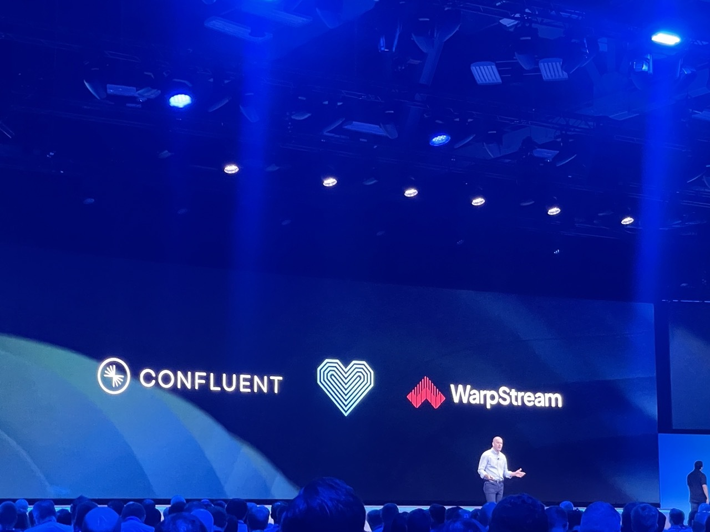
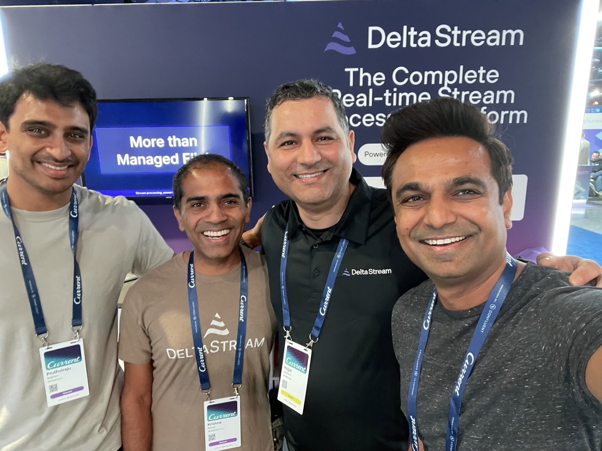
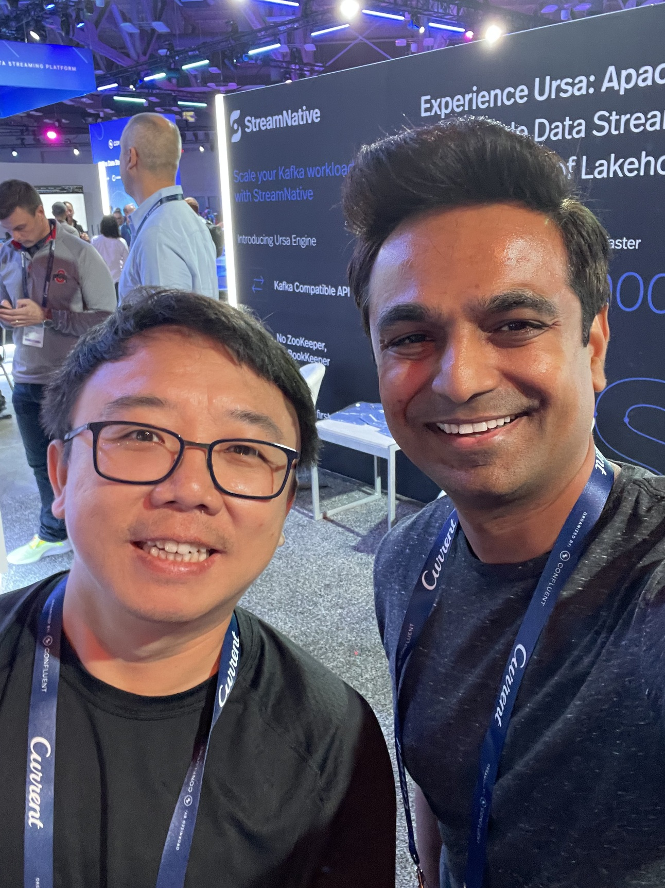
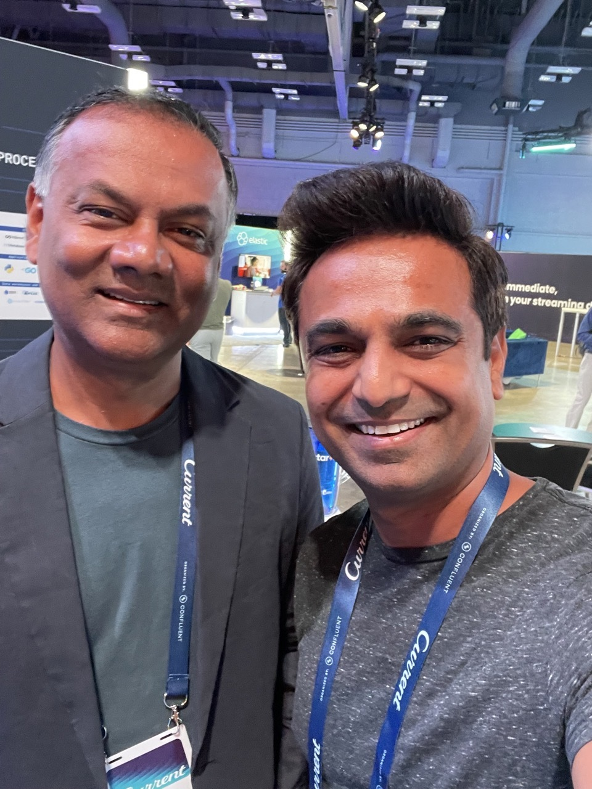
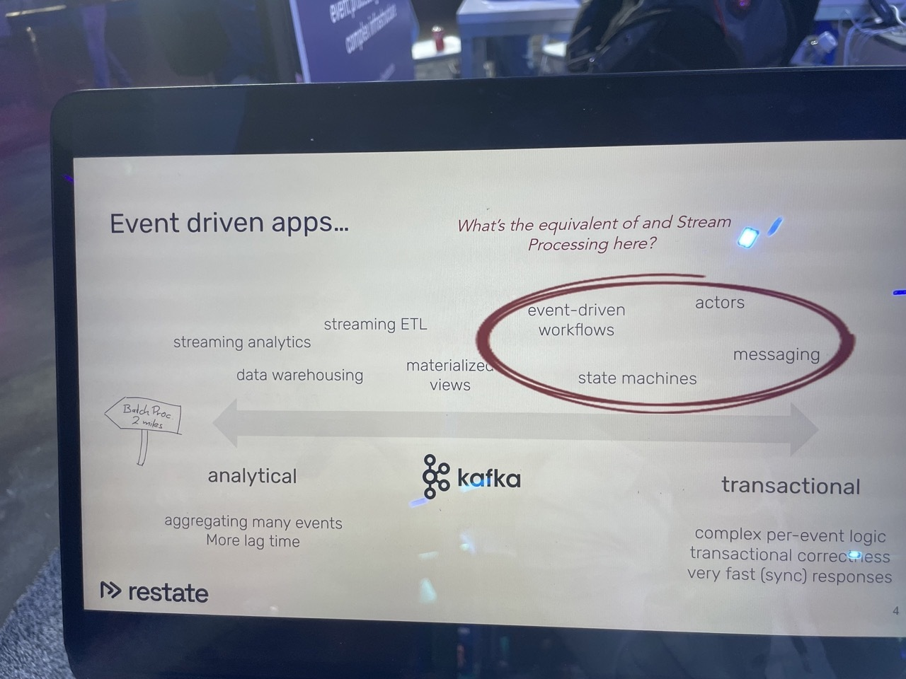
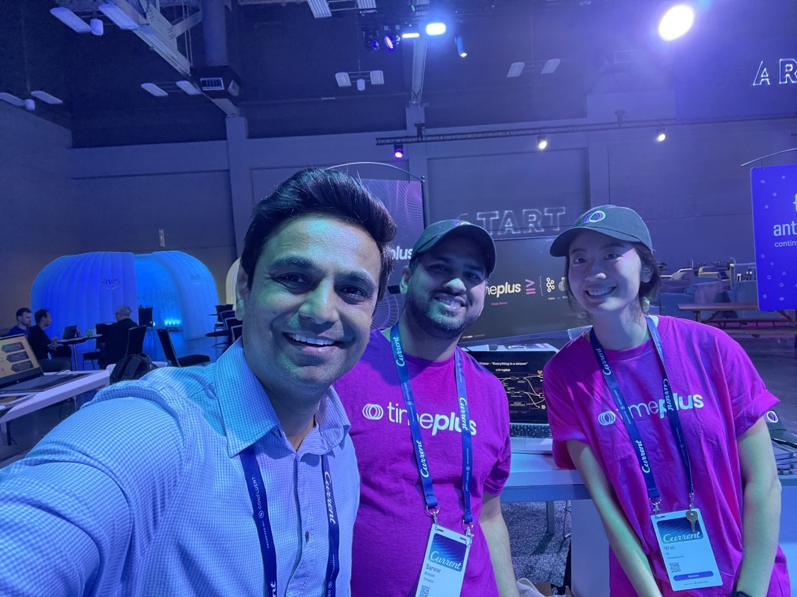

[Current 2024](https://current.confluent.io/), held at the Austin Convention Center from September 17-18, 2024, brought together industry experts, tech leaders, and startups to explore the latest innovations in real-time applications, event-driven architectures, and AI. The event focused on data streaming technologies, particularly Apache Kafka® and Apache Flink®, and how they are being used to power real-time streaming and generative AI use cases. Attendees gained valuable insights into how these technologies are transforming businesses across various industries.

This was my second time attending the two-day event at the Austin Convention Center. At the conference, I reconnected with familiar faces and made plenty of new friends from the Kafka, Flink, and real-time data community.

## Visionaries Unite: Shaping Tomorrow’s Data Landscape with Real-Time Insights

Day 1 of the event kicked off with an impactful [keynote](https://www.youtube.com/watch?v=Sn6fVsOzrSU) featuring Jay Kreps, CEO and Co-Founder of Confluent, alongside industry leaders like Seema Acharya (Mercedes Benz R\&D), Richie Artoul (WarpStream by Confluent), Shaun Clowes (Confluent), Kushal Khandelwal (Viacom18), and Adam Tybor (Accenture).

Each speaker shared insights on the future of data, AI, and real-time streaming, highlighting their experiences and innovations across various industries.

## Engineering the Future: The Data Streaming Revolution and Its Pioneers

Day 2's [keynote](https://www.youtube.com/watch?v=ccupkhcLioM) explored the transformative impact of data streaming on the industry, highlighting the emergence of the Data Streaming Engineer role that unifies the work of application developers, data engineers, data scientists, and architects. Speakers included David Anderson, Tim Berglund, Lucia Cerchie, Danica Fine, Sandon Jacobs, Adi Polak, Anna Povzner, and Matthew Seal, all from Confluent.

Attendees gained valuable insights into the current technologies shaping the Data Streaming Platform and learned how to prepare for their implementation in the coming year.

## Breaking New Ground with BYOC

Confluent formalized the announcement of [acquiring WarpStream,](https://www.confluent.io/blog/confluent-acquires-warpstream/) a Kafka-compatible streaming solution with innovative architecture, to expand its cloud-native streaming offerings. This addition enhances Confluent's ability to meet diverse customer needs with advanced features like offset-preserving replication, cluster quotas and next-gen BYOC architecture.

In just 13 months, [WarpStream](https://www.warpstream.com/blog/warpstream-is-dead-long-live-warpstream) grew its tea,, launched new products, expanded cloud regions, achieved SOC2 Type II certification, and onboarded major customers like Grafana Labs, Zomato, and CharacterAI.

During the keynote, WarpStream founder Richie Artoul discussed the adoption of BYOC (Bring Your Own Cloud) as a cloud service, emphasizing its ability to ensure data sovereignty and security by keeping all data securely within the customer's account.

Confluent Acquires WarpStream

## Spotlighting the Innovators

At the conference, I reconnected with several friends from various companies and made some great new connections.

[DeltaStream](http://www.deltastream.io)

As one of the [founding engineers,](https://www.linkedin.com/posts/mohinishbasha_current24-streamingdata-funding-activity-7242260038663241728-RFY0) I've been part of DeltaStream’s journey since the very beginning, joining the team 3.5 years ago. After raising an initial $10 million in [seed funding](https://www.deltastream.io/seed-funding-post/) from NEA, I played a key role in building out our cloud-based infrastructure, which includes multi-tenant, dedicated, and BYOC offerings.

DeltaStream is founded by [Hojjat Jaffarpour](https://www.linkedin.com/in/hojjatjafarpour/), the original creator of KSQL. Our platform is a serverless, unified stream processing solution designed to simplify the development of stream processing applications by eliminating unnecessary complexity. At the conference, DeltaStream unveiled their [Series A funding round ](https://www.deltastream.io/the-road-to-raising-deltastreams-series-a/)raising $15 million, led by NEA, Galaxy Interactive and Sanabil Investments.

[StreamNative](https://streamnative.io/)

I met [Sijie Guo](https://www.linkedin.com/in/sijieg/), the founder of StreamNative, at their booth and had an engaging conversation about the importance of BYOC and serverless solutions in their go-to-market strategy. Sijie is a member of the Apache Software Foundation (ASF), serving as a PMC member, committer, and contributor for projects like Apache Pulsar, Apache Bookeeping and Apache Doris.

StreamNative has re-architected data streaming from the ground up for cloud-native environments using Apache Pulsar. Their ONE StreamNative Platform, powered by the Ursa engine, provides a scalable, high-performance, and cost-efficient data streaming solution that is compatible with the Kafka API and can run on any cloud.

Sijie Guo, creator of Apache Pulsar, Founder @ StreamNative

[RisingWave](https://risingwave.com/)

RisingWave is on my favorite [stream processing runtime](https://github.com/risingwavelabs/risingwave), that unified both batch and streaming data and is postgres compatible. RisingWave aims to democratize stream processing by making it simple, affordable, and accessible.

Yingjun, the talented founder of Rising Wave, previously was a software engineer on the Redshift team at AWS and a researcher at IBM Almaden Research Center, holds a PhD from the National University of Singapore and was a visiting PhD at Carnegie Mellon University.

RisingWave has 2 product lines, [the Rising Wave Cloud](https://risingwave.com/cloud/) and [the Rising Wave streaming database](https://risingwave.com/database/), all built in RUST to provide continuous analytics, build event-driven applications, real-time ETL pipelines, and feature stores in minutes.

I met up with [Rayees Pasha](https://www.linkedin.com/in/rayees-pasha/) at the conference, who leads product at RisingWave.

Rayees Pasha @ RisingWave

[Restate](https://restate.dev/)

[Stephan Ewen](https://www.linkedin.com/in/stephanewen/), [Till Rohrmann](https://www.linkedin.com/in/tillrohrmann/) and [Igal Shilman](https://www.linkedin.com/in/igal-shilman-2027a76/) are the co-founders of Restate. Till also serves as an advisor for various companies using Apache Flink, including DeltaStream.

Restate at the core has build a durable state execution engine to provide the simplest way to build resilent applications. Restate is on a mission to simplify modern distributed applications by enhancing their resilience, reliability, and fault tolerance.

Their team features co-creators of Apache Flink and distributed processing experts from renowned companies like Apple, Stripe, Amazon, and Meta.

Restate provides durable state execution engine using kafka

[Responsive](https://www.responsive.dev/)

Responsive is yet another company emerging from the Confluent mafia cohort, and if you ever found KStreams to be challenging to work with, they’ve created a product that makes it incredibly simple.\
\
I met the three remarkable founders—[Apurva Mehta](https://www.linkedin.com/in/apurvarmehta/), [Rohan Desai](https://www.linkedin.com/in/rohanpd/), [Almog Garva](https://www.linkedin.com/in/agavra/)—at their booth. In their previous roles at Confluent, they were pivotal in the development of KStreams and KSQL.

[AntiThesis](https://antithesis.com/)

This was my top discovery product on the floor. In the past, we relied heavily on system tests at Confluent to evaluate Kafka, but these tests often fell short in catching edge cases across the wide range of Kafka configurations.

AntiThesis addresses this challenge by offering autonomous testing for distributed systems. Their product is utilized for black box testing by notable companies such as Ethereum, Palantir, and MongoDB. Discover how [WarpStream leverages AntiThesis](https://www.warpstream.com/blog/deterministic-simulation-testing-for-our-entire-saas) in this blog post.

[Timeplus](https://www.timeplus.com/)

Timeplus is a SQL stream processing and analytics engine that combines columnar and row stores within a single binary. It enables the creation of real-time applications for both edge and cloud environments. I had a fantastic time chatting with [Jove Zhong](https://www.linkedin.com/in/jovezhong/), Co-founder and Head of Product at TimePlus, about the inner workings of TimePlus and especially their [Proton engine](https://docs.timeplus.com/proton).

TimePlus Team - Sarwar Bhuiyan, Wei Q

[FactorHouse](https://factorhouse.io/)

FactorHouse aims to empower engineers with tools that simplify working with Apache Kafka and Apache Flink, making real-time streaming compute a seamless and enjoyable experience. They provide an integration and observability platform for stream processing with products like [Flow](https://factorhouse.io/flow/) Integration platform, [KPow](https://factorhouse.io/kpow/) for Apache Kafka and [Flex](https://factorhouse.io/flex/) for Apache Flink.

Founded by Derek and Kylie Troy-West in 2019, FactorHouse leverages extensive experience with Apache Kafka, Cassandra, and Storm to deliver data platforms for global banking, insurance, and fintech.

Their tools are immensely popular, with hundreds of thousands of installations worldwide. Fun fact: they’ve bootstrapped the company since 2019, and a little birdie told me they’re about to announce their seed funding round soon.

[Datorios](http://datorios.com)

Coming from Israel, Datorios aims to democratize real-time data processing with a development console for Apache Flink, empowering engineering teams to make stream processing standard and unlock their companies' real-time potential.

While visiting the booth, I learned Datorios builds and develops their own distribution of Apache Flink.

[LittleHorse](https://littlehorse.dev/)

I had a great lunch with [Colt McNealy](https://www.linkedin.com/in/colt-mcnealy-900b7a148/) at the conference. If you've worked with Kafka Streams, you're likely familiar with Colt or [LittleHorse](https://littlehorse.dev/)!\
\
[LitteHorse](http://littlehorse.io) enables the creation of workflow-driven applications by offering durable state execution with Kafka Streams, allowing for the rapid composition and deployment of microservices to enhance developer agility in meeting business demands.

[ThatDot](https://www.thatdot.com/)

Have you ever considered writing stream processing applications using Graph instead of Apache Kafka? Enter [thatDot](https://www.thatdot.com/), the creators of Quine OSS, who present the world’s first streaming graph analytics engine, developed over eight years for advanced persistent threat detection at Darpa and funded by Crowdstrike.

[Ryan Wright](https://www.linkedin.com/in/wrightryan/), the CTO and Founder of thatDot, always offers engaging conversations about graph-based stream processing, threat detection, and fraud analysis.

[Platformatory](https://platformatory.io/)

Based out of Bengaluru, Platformatory provides consulting, system integration, and platform engineering for streaming data solutions. [Pavan Keshavamurthy](https://www.linkedin.com/in/pavankmurthy/), the founder of Platformatory is a quite popular speaker in the streaming circles.

His talk [Events at the (API) Horizon: How to synthesize domain events & changes from your HTTP/REST APIs](https://events.bizzabo.com/599116/agenda/session/1336705)**&#x20;**&#x61;t the conference introduced an alternative approach that utilizes standard API proxies or gateway solutions to process and push events to Kafka directly from the API data plane, reducing the need for extensive code changes and complex CDC implementations.

[Feldera](https://www.feldera.com/)

[Lalith Suresh](https://www.linkedin.com/in/lalith-suresh-34bb8911/), CEO and Founder of Feldera, has developed an incremental computational data engine that enables rapid analysis of live and historical data with full SQL processing, handling millions of events per second and scaling to datasets larger than memory for AI use cases.

An incremental computational data engine is essential for RAG and AI use cases as it allows for real-time analysis and processing of vast amounts of data, enabling timely insights and decisions.

[ShadowTraffic](https://shadowtraffic.io/)

You might have seen a [walking QR code](https://www.linkedin.com/posts/michael-drogalis_it-didnt-make-sense-to-get-an-expo-booth-activity-7241420971436343296-FAsv) invite for a free Kafka test stream, encouraging you to check out ShadowTraffic, created by the talented [Michael Drogralis](https://www.linkedin.com/in/michael-drogalis/), who previously managed the KStreams and KSQL products at Confluent.

Follow his journey as a solo bootstrapped entrepreneur running ShadowTraffic (yet another company by Confluent Mafia #yacbcm), achieving around $100k in ARR, on LinkedIn.

[InfinyOn](https://infinyon.com/)

InfinyOn, a real-time event streaming company, has secured $5 million in seed funding led by Gradient Ventures and Fly Ventures, with participation from Bessemer Venture Partners and others.

The company aims to enhance customer experiences through its modern cloud-native event streaming platform, which features in-line computation powered by WebAssembly, enabling large-scale multi-channel dataflows.

With strong traction across various industries and recognition on G2’s list for Event Stream Processing Software, InfinyOn leverages its Fluvio Open Source platform, built in Rust, to simplify data architectures and improve efficiency while maintaining high security and low memory usage.

[Debadyuti Roy Chowdhury](https://www.linkedin.com/in/debadyutirc/), who is a great friend, runs the product organization at InfinyOn.

## Final Thoughts

The data streaming world gathered in Austin, Texas for Current 2024, uniting the community in an exhilarating celebration of all things Apache Kafka® and Apache Flink®. Attendees were treated to insights from tech leaders, industry giants, and startups, who filled the air with a wealth of knowledge about real-time event streaming and beyond.

What an exciting time to connect and learn together on topics like private saas, serverless, byoc, durarable state execution, streaming lineage, streaming observability, making kafka protocol more efficient! Innovation in real time data opens up exciting opportunities that inspire creativity to drive transformative changes across industries.
