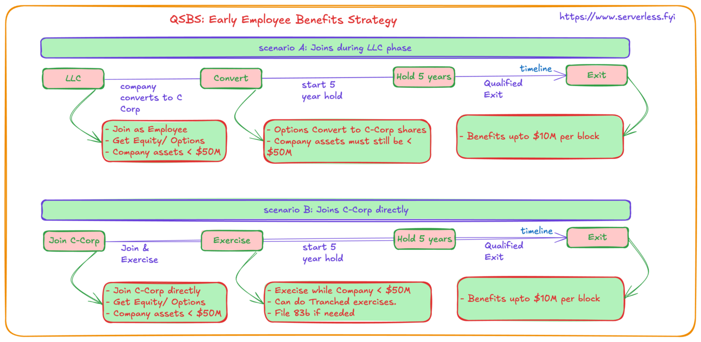
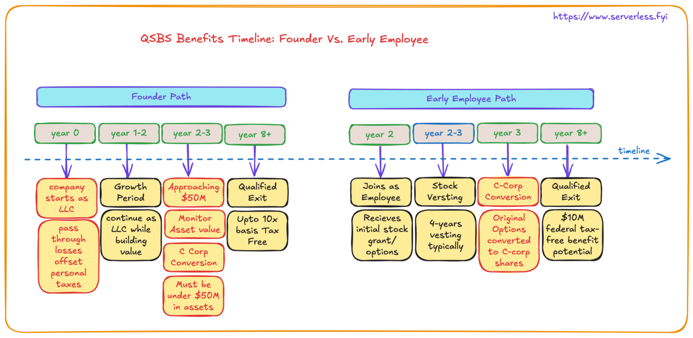

## QSBS Benefits for Early Employees

Early employees can also take advantage of QSBS benefits, though their strategy differs from founders. Here's what early employees need to know:

## Strategic Playbook for Early Employees

1. Stock Acquisition

   - Must receive stock directly from the company (not secondary market)
   - Options or restricted stock count if exercised while company qualifies
   - Stock must be held for 5+ years after exercise

2. Timing Considerations

   - QSBS status starts from option exercise date, not grant date
   - Early exercise can start the 5-year clock sooner
   - Must exercise while company is under $50M in assets

3. Maximum Benefits

   - Up to $10M in gains can be tax-free
   - Unlike founders, early employees typically don't benefit from the 10x basis rule
   - Multiple stock grants/exercises can each qualify separately

Early Employee Tax Saving Example

```text
- Joins when company is worth $20M
- Receives options for 1% of company
- Exercises options early at $200K
- Company sells for $1B
- Employee's share: $10M
- Potential tax savings: ~$2.4M (assuming 23.8% federal capital gains rate)
```

### Strategic Planning for Early Employees

1. Early Exercise Considerations

   - Pros:

     - Starts 5-year holding period earlier
     - Potentially lower exercise price
     - Better tax treatment (if 83(b) election filed)

   - Cons:

     - Requires upfront capital
     - Risk if company fails
     - Must file 83(b) election within 30 days

2. Documentation Needs

   - Keep records of:

     - Original grant documents
     - Exercise dates and prices
     - 83(b) election filing (if applicable)
     - Proof of company's qualification at exercise time

3. Optimization Strategies

   - Consider exercising in tranches to spread out risk
   - Time exercises before major funding rounds
   - Coordinate with tax advisor on exercise timing

## Early Employee Strategies

Early employees have two potential paths to QSBS benefits:

### Path 1: Joining During LLC Phase

- Receive equity/options during LLC period
- Wait for C-corp conversion
- 5-year clock starts at conversion
- Benefits: Up to $10M tax-free per block of shares

### Path 2: Joining C-Corp Directly

- Join when company is already a C-corp
- Must exercise while company is under $50M in assets
- 5-year clock starts at exercise
- Benefits: Up to $10M tax-free per block of shares

### Early Exercise Strategy for Maximum Tax Benefit

Scenario A: Early Exercise Strategy

```text
- Join C-corp valued at $30M
- Receive options for 0.5% of company
- Exercise immediately at $150K
- Company sells in 6 years for $2B
- Your share: $10M - Entire gain could be tax-free under QSBS
```

Scenario B: Gradual Exercise Strategy

```text
- Join C-corp valued at $40M
- Receive options for 1% of company
- Exercise in tranches while under $50M
- Each exercise starts its own 5-year clock
- Multiple blocks of QSBS qualification
- Can potentially stack multiple $10M exemptions
```



### Key Differences from Founder Benefits

1. Basis Calculation

   - Founders: Can use company value at C-corp conversion
   - Employees: Use exercise price of options

2. Maximum Benefit

   - Founders: Greater of $10M or 10x basis
   - Employees: Generally limited to $10M per block of shares

3. Timing Strategy

   - Founders: Focus on LLC to C-corp conversion timing
   - Employees: Focus on exercise timing



### Action Items for Early Employees

1. Immediate Steps

   - Confirm company's QSBS eligibility
   - Review grant documents
   - Consider early exercise options
   - Consult tax advisor

2. Ongoing Monitoring

   - Track company's asset value
   - Monitor vesting schedule
   - Plan exercise timing
   - Document all transactions

3. Exit Planning

   - Calculate holding periods for each share block
   - Understand impact of different exit scenarios
   - Plan tax strategy for non-qualifying shares

### Best Practices for Maximum Benefit

1. Communication

   - Stay informed about company's asset value
   - Understand company's plans for future funding
   - Keep open dialogue with management about QSBS status

2. Financial Planning

   - Budget for early exercises if possible
   - Consider loans or financing options for exercises
   - Plan for alternative scenarios if QSBS doesn't qualify

3. Professional Support

   - Work with tax advisor familiar with QSBS
   - Consider legal counsel for complex situations
   - Keep detailed records of all transactions

### The Bottom Line for Early Employees

While early employees may not access the same magnitude of QSBS benefits as founders, the potential tax savings are still substantial. The key is understanding your options early and planning strategically around exercise timing and holding periods. The most successful early employees treat their equity compensation as a crucial part of their overall financial planning, making informed decisions about when and how to exercise their options to maximize QSBS benefits.

Disclaimer: Not tax advice - consult your advisors, but definitely worth exploring!
