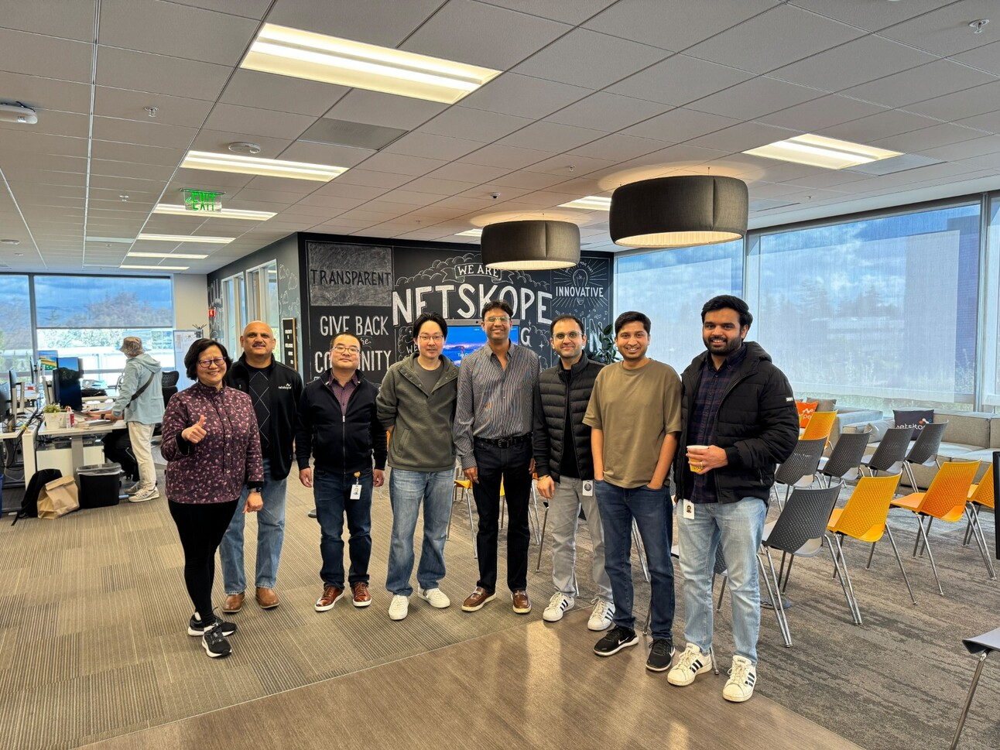
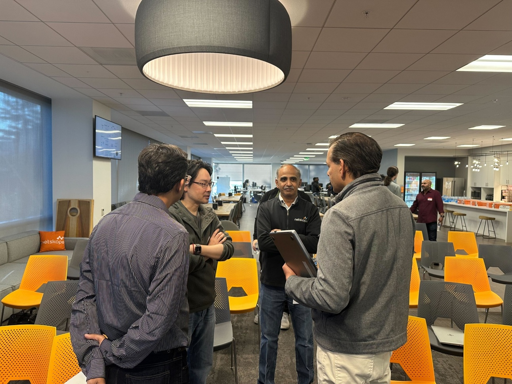
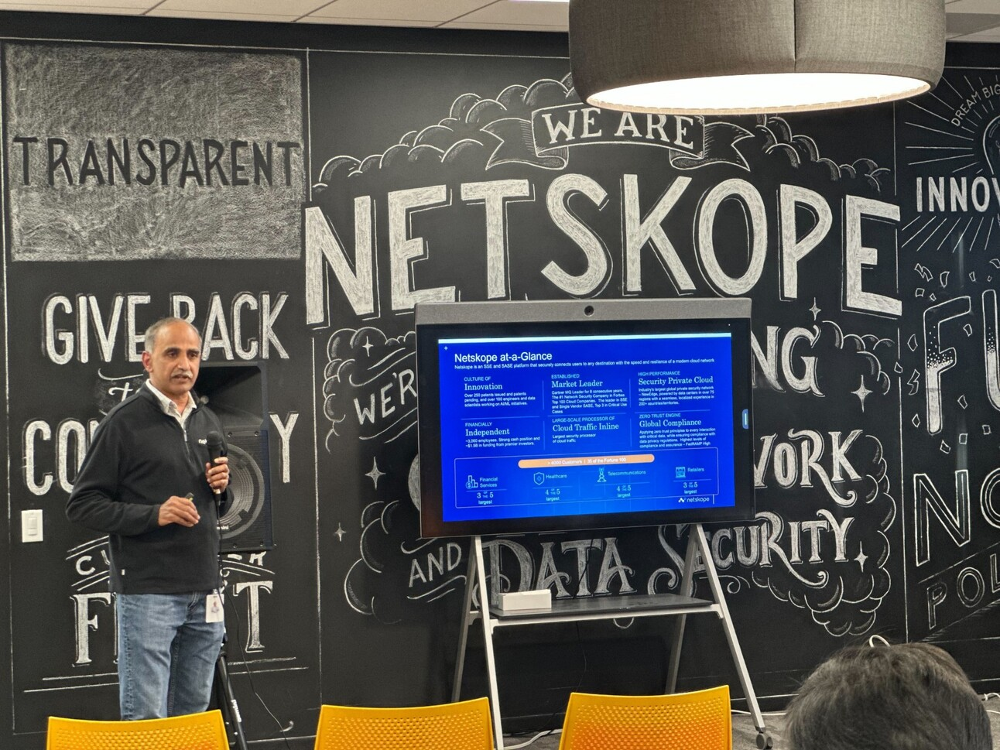
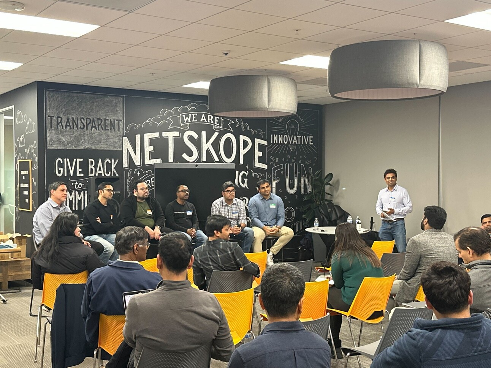
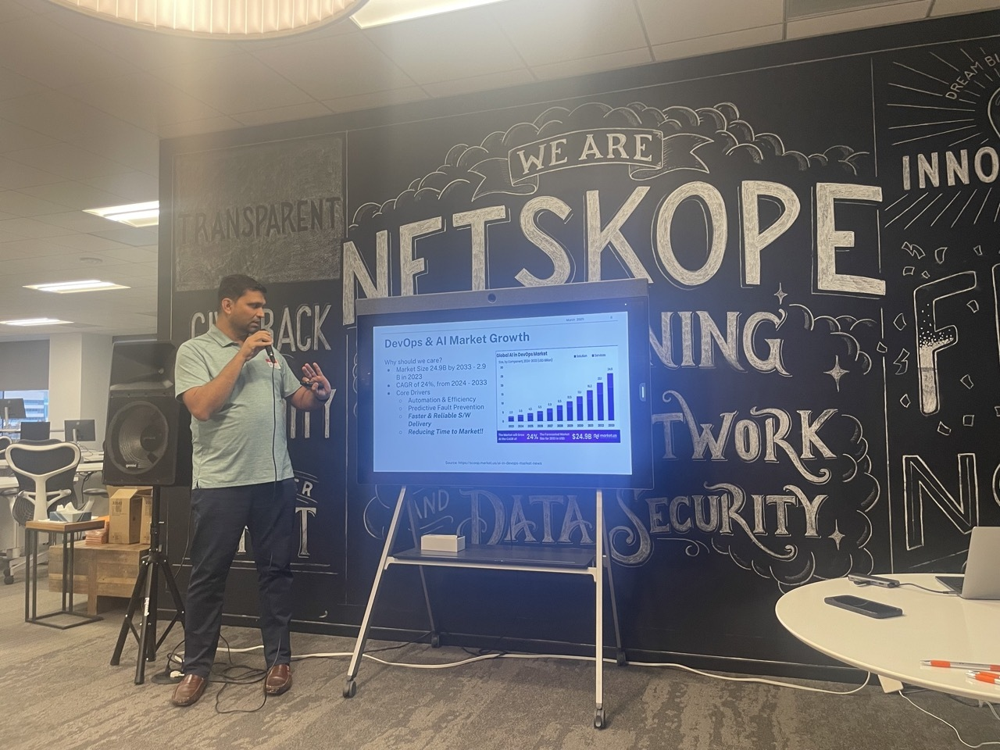
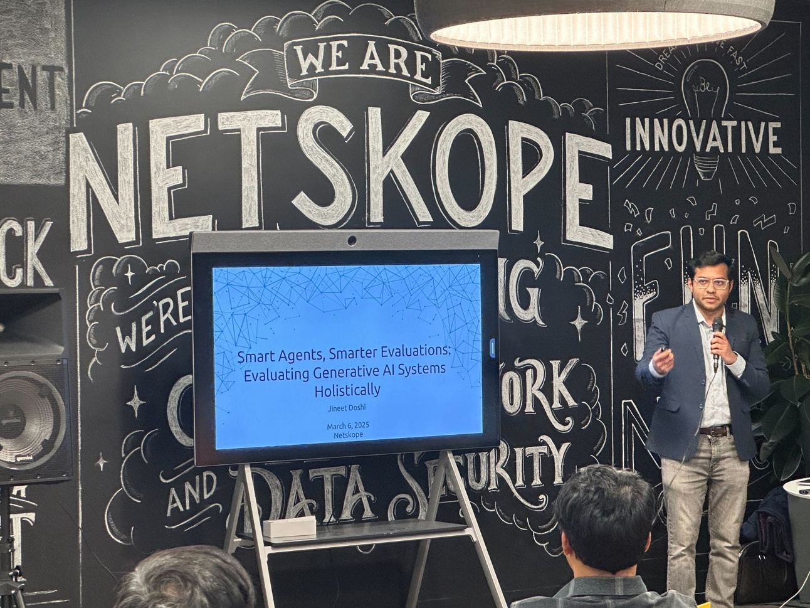
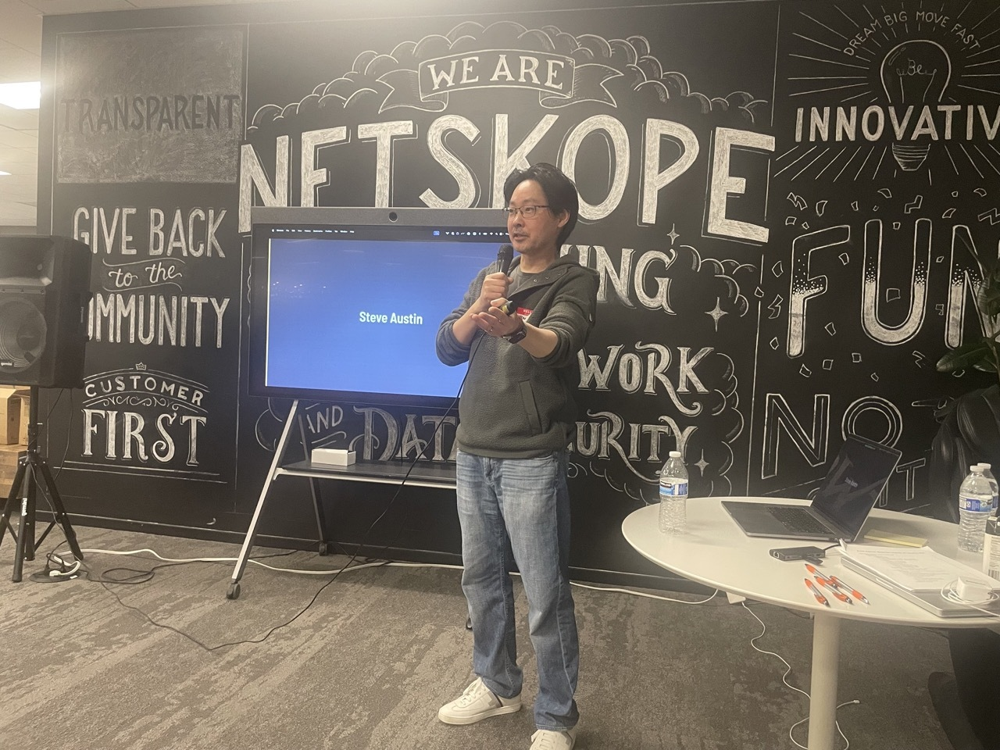
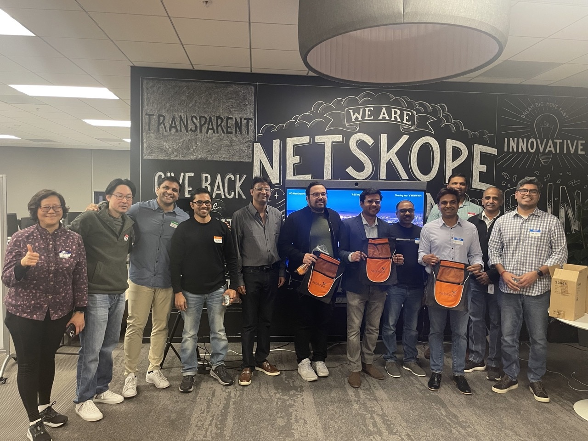

## Post-Event Update

On March 6th, 2025, Serverless community came together for an exclusive engineering and technology meetup at Netskope HQ which brought together over 60 industry leaders, innovators, and experts in AI, SRE, security, DevOps, data science, and infrastructure. The event fostered meaningful connections, sparked insightful discussions, and provided a deep dive into emerging trends shaping the industry. With an engaging agenda featuring technical talks, a thought-provoking panel discussion, and plenty of networking opportunities, attendees walked away with valuable insights and new collaborations.

---

**Meetup Agenda**

The evening kicked off with a warm welcome and introductions, setting the stage for the deep technical conversations to follow. The agenda was structured to provide a mix of expert insights, interactive discussions, and opportunities for networking.

- **Opening Keynote:** Krishna Narayanaswamy, CTO, Netskope

- **Technical Talks:**

  - Atul Kulkarni (Amazon Rufus) on AI-driven DevOps pipelines
  - Jineet Doshi (Intuit) on evaluating generative AI systems

- **Panel Discussion:** Industry leaders discussed the intersection of Agentic AI, SRE, security, and DevOps

- **Closing Remarks:** John Cho, SVP Engineering, Netskope

- **Networking Session:** Unstructured mingling to encourage collaborations

---

### Technical Talk and Panel Discussion Details

The first technical talk, **"Smart Ops: Building the AI-Enhanced DevOps Pipeline,"** was delivered by **Atul Kulkarni**, an engineering leader at Amazon Rufus. He provided a deep dive into AI-driven automation in DevOps, explaining how AI can streamline operational workflows, enhance system reliability, and optimize performance.

Following this, **Jineet Doshi**, AI Lead at Intuit, presented **"Smart Agents, Smarter Evaluations: Evaluating Generative AI Systems Holistically."** His talk explored best practices for assessing AI agent performance, measuring effectiveness, and ensuring robust real-world applications through comprehensive evaluation frameworks.

The panel discussion was a highlight of the evening, featuring industry experts from [AWS](https://aws.amazon.com/), [Sully.AI](https://sully.ai), [OpsVerse](https://opsverse.io/), [PlayerZeroAI](https://playerzero.ai/), [ArizeAI](https://arize.com/), and [KumoAI](https://kumo.ai/). Moderated by a seasoned expert, the discussion explored the challenges and opportunities at the intersection of Agentic AI, SRE, and security, covering topics such as enhancing developer productivity and optimizing large-scale AI systems.

---

**An Evening of Insightful Discussions**

The meetup provided a platform for attendees to share experiences, discuss emerging trends, and gain insights from some of the brightest minds in the field. The interactive nature of the talks and panel discussion allowed for engaging Q\&A sessions, enabling participants to explore topics relevant to their work and challenges.

---

**Expert Panel:**

The panel discussion featured:

- **Rueben Jimenez**, AI Architect at [AWS](https://aws.amazon.com/)
- **Chaitanya Gharpure**, Co-Founder and CTO at [Sully.AI](https://sully.ai)
- **Arul Francis**, Co-Founder at [OpsVerse](https://opsverse.io/)
- **Animesh Koratana**, Founder at [PlayerZeroAI](https://playerzero.ai/)
- **Hakan Tekgul**, AI Solutions at [ArizeAI](https://arize.com/)
- **Parth Pareek**, Product at [KumoAI](https://kumo.ai/)

These industry leaders shared valuable insights during the panel discussion, enriching the event with their expertise.

These experts provided deep insights into the current and future landscape of AI-driven operations, security, and infrastructure management. Discussions revolved around real-world case studies, best practices, and the impact of AI in scaling engineering operations.

---

**Fostering Connections & Collaboration**

Beyond the structured agenda, the event facilitated valuable networking opportunities. Attendees had the chance to connect with industry peers, exchange ideas, and explore potential collaborations. The atmosphere was electric with discussions ranging from AI-powered automation to innovative approaches in security and infrastructure.

---

**A Huge Thank You!**

A big thank you to **Netskope** for hosting this fantastic event and to all the speakers and panelists for sharing their expertise. Special appreciation to the attendees for making this gathering a success by contributing to meaningful discussions and fostering a collaborative environment.

Stay tuned for future events as we continue to bring together the best minds in AI, SRE, DevOps, and beyond! 🚀

