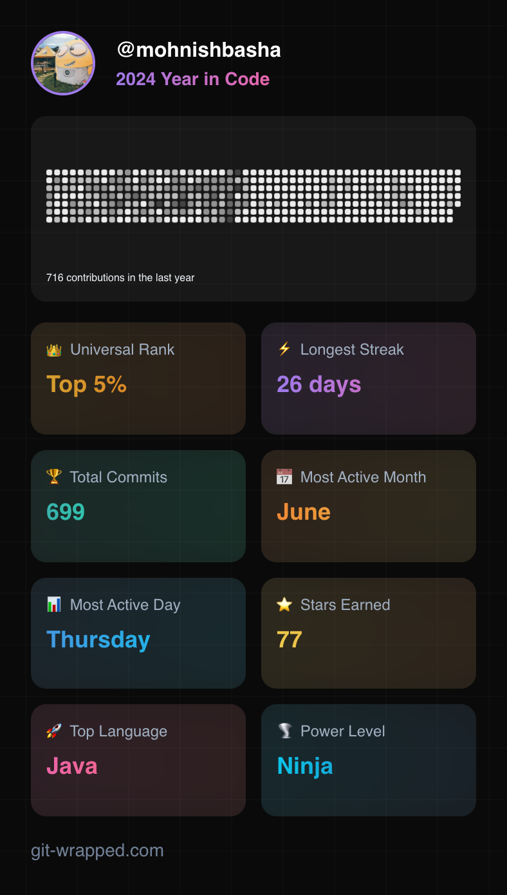
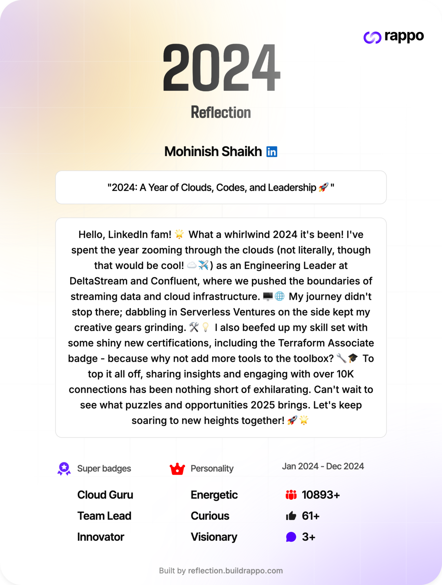

As 2024 came to a close, I find myself reflecting on a year filled with opportunities, challenges, and growth. From deepening my involvement in the tech community to pushing the boundaries of what’s possible in cloud infrastructure and stream processing, this year has been nothing short of transformative. In this post, I’ll share highlights from my professional journey, community contributions, and the personal growth that defined my year.

---

## DeltaStream - The Complete Stream Processing Data Platform.

During my time at [DeltaStream](https://www.deltastream.io), I played a key role in building a cutting-edge stream processing platform from the ground up, focused on empowering companies to derive real-time insights from their data.\
\
As a founding member of engineering team, I worked on shaping the product vision, scaling the architecture, and fostering a culture of innovation within the team. Through collaboration and perseverance, we successfully grew the company and achieved Series A funding, establishing DeltaStream as a leader in the stream processing space.

As Head of Cloud Infrastructure at DeltaStream, I architected, engineered, and managed the entire cloud ecosystem. This included developing control plane, multi-tenant dataplane, dedicated dataplane, BYOC dataplane, and implementing cloud connectivity solutions to integrate multiple data-planes with the control plane.\
\
Midway through 2024, I decided to take a personal sabbatical, reflecting on and celebrating the completion of this rewarding journey.

### Career Break

During my career break, I took the opportunity to travel and reflect on my next steps. Having recently moved to Texas, I explored its diverse cities and towns, including Dallas, Houston, League City, Texas City, Port Lavaca, Galveston, Corpus Christi, Fort Worth, Irving, San Antonio, and Fredericksburg.\
\
Alongside traveling, I spent time reading impactful papers such as _Google File System_, _Dynamo_, _BigTable_, _Cassandra_, _Spanner_, _Kora_, and _ClickHouse_. Check them out:\
\
\- Google File System: A Scalable distributed file system for large workloads\
\- Dynamo: -Amazon's Highly Available Key Value Store\
\- BigTable: Google's Distributed Storage System for structured data\
\- Cassandra: A Scalable NoSQL database with tunable consistency.\
\- Spanner: Google’s globally distributed and strongly consistent database.\
\- Kora: A Cloud-Native Event Streaming Platform For Kafka\
\- ClickHouse - Lightning Fast Analytics for Everyone\
\
Through my network, I've discovered compelling open-source projects like [SlateDB](https://www.slatedb.io) (an embedded Rush database for S3) and [TektiteDB](https://www.tektitedb.io) (a Go-based streaming store with native processing). My focus remains on developing innovative infrastructure, stream processing, and distributed systems, particularly for AI applications.

### GitHub 2024

I maintained an active GitHub presence, contributing to DeltaStream repositories and personal projects.

Check out my 2024 Wrapped! [https://git-wrapped.com/profiles/mohnishbasha](https://git-wrapped.com/profiles/mohnishbasha)

---

### Serverless Newsletter

The [**Serverless Newsletter**](https://www.serverless.fyi) became an integral part of my routine in 2024. Curating and sharing insights about serverless architecture trends allowed me to connect with a broader audience of founders, investors, and early-stage employees.\
\
The Serverless Newsletter is a curated publication I maintain to share insights, trends, and best practices in AI, Data, InfraStructure, Distributed Systems, Startup Hustle and Career Guidance. It serves as a resource for developers, architects, fellow engineers and enthusiasts, highlighting advancements, practical use cases, and innovative ideas in the ecosystem.

Alongside the newsletter, I organized serverless social meetups to foster a sense of community among professionals. These gatherings create a space for knowledge-sharing, collaboration, and networking, allowing participants to discuss challenges, solutions, and emerging opportunities in serverless technologies. Together, the newsletter and meetups contribute to community building and advancing the broader adoption of serverless paradigms in the tech industry.\
\
The newsletter’s subscriber base grew by 200%, a testament to the shared curiosity within this community. Writing for the newsletter not only solidified my own understanding but also helped foster meaningful discussions around where technology is headed.

---

### Community Collaboration

Professionally, 2024 was a rewarding year. I continued advising pre-seed startups, helping them navigate the complexities of scaling enterprise software and implementing real-time data strategies. One of the standout moments was contributing to a founder’s journey at [Rappo](https://www.buildrappo.com/) to secure a early pre-seed round by refining their pitch deck and product distribution strategy to capture metrics and usage insights.

Check out my personalized reflection card and create yours at [https://reflection.buildrappo.com/](https://reflection.buildrappo.com/)

[Rappo](https://www.buildrappo.com/) is a platform for **[champions](https://www.buildrappo.com/#who-is-champion)** to explore new tools, products, network with peers and early stage technical founders.

---

### Year of Self-Reflection and Improvements

Beyond professional milestones, 2024 was also a year of introspection. Balancing a busy schedule with personal growth, I prioritized fitness, hiking, and paddle boarding—activities that not only kept me physically active but also offered mental clarity. Reading became a source of both relaxation and inspiration, with books on leadership and emerging technologies shaping my perspective.

This year also challenged me to be more intentional with my time and energy. Stepping back to reflect on my goals allowed me to align my professional pursuits with my long-term aspirations, ensuring that my work remains fulfilling and impactful.

---

**What's Next for 2025**

I see 2025 as the year of exponential growth and opportunities for myself, where I can push the boundaries of infrastructure building for AI applications. With rapid advancements in artificial intelligence and distributed systems, I plan to leverage my expertise in cloud infrastructure to tackle emerging challenges. I aim to drive innovations that will support the scalability and reliability of AI-driven solutions, creating more resilient and efficient systems. By working with cutting-edge technologies and collaborating with forward-thinking teams, I expect to make a significant impact and continue growing both professionally and personally.

In addition, I want to see my reach grow wider, hopefully unlocking more opportunities to build and collaborate with the community, fostering stronger connections and contributing to projects that will shape the future of technology.

---

Looking back, 2024 was a year of building—in every sense of the word. From contributing to open-source projects and growing the **Serverless Newsletter** to achieving professional milestones and deepening personal insights, it’s been a year of meaningful progress. As I look ahead to 2025, I’m excited to continue exploring interesting problem domains, building community, and creating value in the ever-evolving world of technology.

Thank you for being part of this journey. Here’s to another year of learning and growth!
