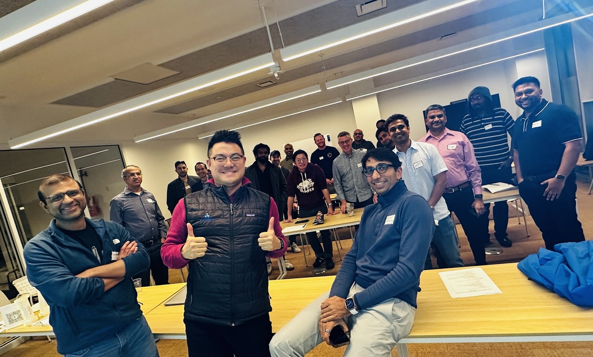
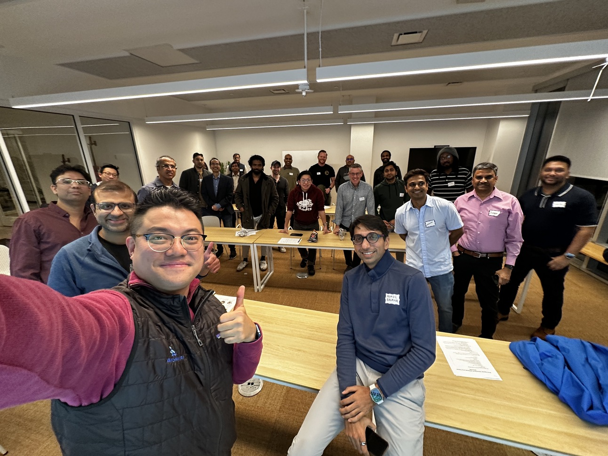
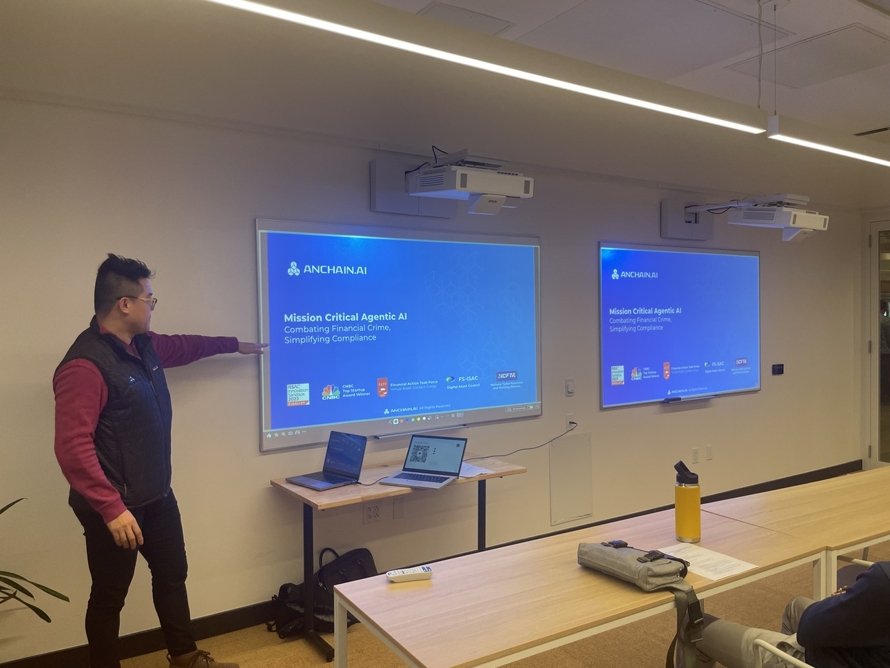
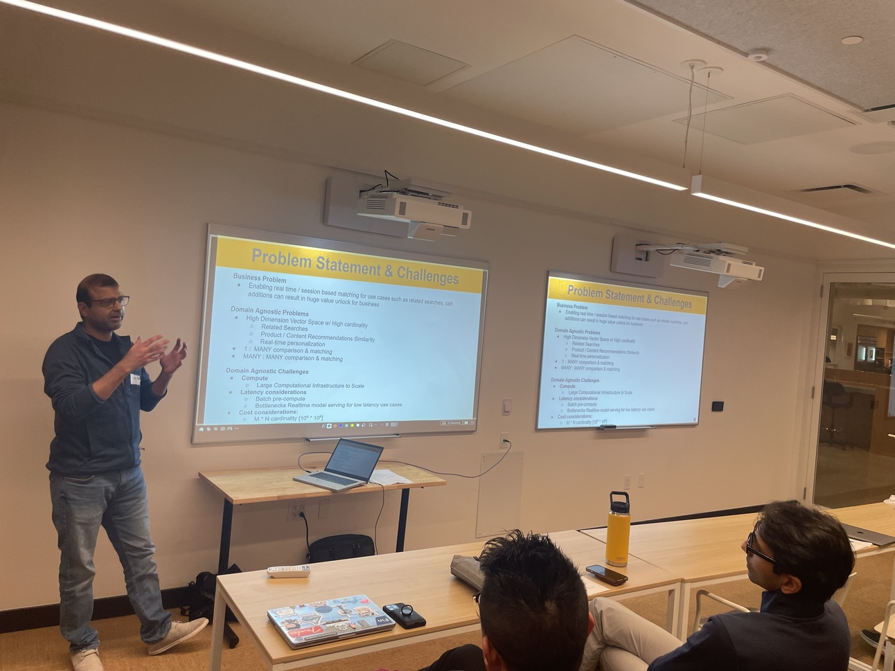
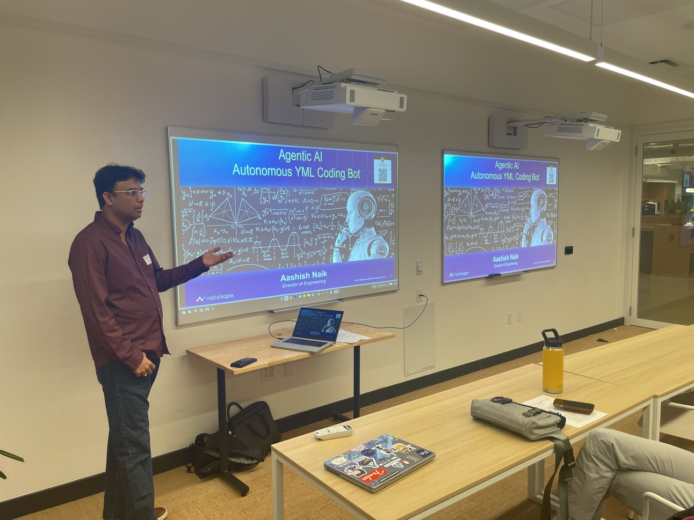
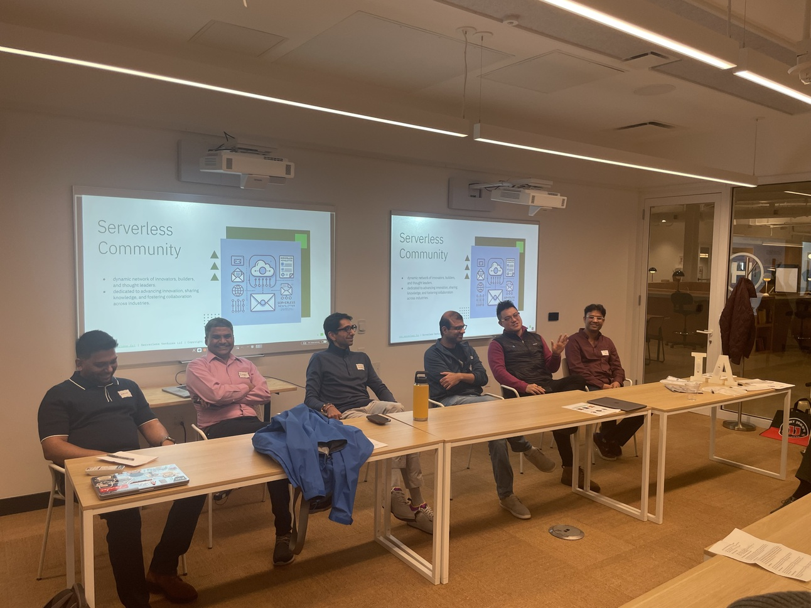
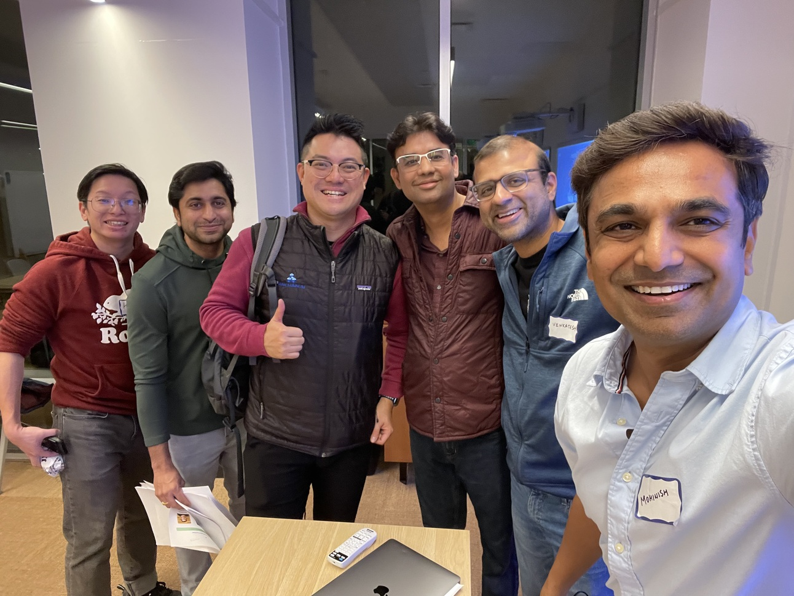

## Post-Event Update: Serverless ft. AnChainAI | AI in Fintech Meetup

This past week on Jan 29th 2025, we hosted an incredible evening at the [**Serverless ft. AnChainAI | AI in Fintech Meetup**](https://lu.ma/08hdn03b), bringing together an exclusive group of AI, data, and fintech leaders for deep discussions, knowledge sharing, and high-impact networking. It was an honor to welcome a carefully curated group of 25 attendees from companies like Wayfair, Netskope, AnChain, Adobe, Meta, SpyCloud, and Capital One, ensuring a meaningful exchange of ideas and insights.

### An Evening of Insightful Discussions

We kicked off with warm introductions, setting the stage for an engaging and interactive session. The event featured three thought-provoking technical talks, each offering a unique perspective on AI's evolving role in fintech, security, and compliance.

🔹 [**Dr. Victor Fang**](https://www.linkedin.com/in/drvictorfang/), Founder & CEO of [AnChain.AI](https://anchain.ai), shared how **Agentic AI is disrupting the fintech industry**—reducing operational costs by 3x, improving accuracy by 90%, and addressing $14 billion in annual financial crime fines with unprecedented efficiency.

🔹 [**Aashish Naik**](https://www.linkedin.com/in/naikaa/), Engineering Director, AIOps at [Netskope](https://www.netskope.com/), introduced us to **Macaw, an Agentic AI YAML Coding Bot**, showcasing how AI-driven automation is revolutionizing infrastructure and security management.

🔹 [**Venkatesh Chitnis**](https://www.linkedin.com/in/venkatesh-chitnis/), Engineering Leader, MLOps at [Wayfair](https://www.wayfair.com/), discussed **securing low-latency inferencing for real-time ML use cases**, highlighting the critical balance between speed and security in AI-powered applications.

### Expert Panel: AI & Fintech at the Crossroads

A highlight of the evening was our panel discussion, where top industry experts explored the evolving landscape of AI in fintech, compliance, and security.

The panel featured:

- [**Dr. Victor Fang**](https://www.linkedin.com/in/drvictorfang/), Founder, [AnChain.AI](https://anchain.ai)
- [**Aashish Naik**](https://www.linkedin.com/in/naikaa/), Director AIOps, [Netskope](https://www.netskope.com/)
- [**Venkatesh Chitnis**](https://www.linkedin.com/in/venkatesh-chitnis/), Engineering Leader, MLOps, [Wayfair](https://www.wayfair.com/)
- [**Suresh Mandava**](https://www.linkedin.com/in/mandavasuresh/), Founder, [Unovie](https://unovie.ai/) (Edge-based Agentic AI Platform)
- [**Kareem Fazal**](https://www.linkedin.com/in/kareem-fazal-30288212/), Principal Program Manager, [Microsoft](https://www.microsoft.com/en-us/)
- [**Mukul Bafana**](https://www.linkedin.com/in/mukulbafana/), Co-Founder, [Omuni](https://omuni.com/)

The discussion delved into the **pressing challenges and emerging trends** shaping the industry, from the ethical implications of AI-driven compliance to the increasing role of automation in mitigating financial fraud.

### Fostering Connections & Collaboration

One of the most valuable aspects of the event was the **networking session**, where attendees had the chance to connect, exchange ideas, and explore potential collaborations. With a room full of fintech leaders, AI engineers, investors, and startup founders, the conversations were rich with insights and opportunities.

---

### Disrupting FinTech and SaaS: Dr. Victor Fang's Insights on Agentic AI

Dr. Victor Fang’s technical talk, “How Agentic AI is Transforming FinTech and Combating Financial Crimes,” was a highlight at the recent Agentic AI event. His insightful presentation explored how Agentic AI is reshaping the financial technology landscape, particularly in the areas of financial crime prevention and risk management. Fang also expressed his gratitude for the engaging panel, which featured thought leaders like Mohinish Shaikh, Aashish Naik, Mukul Bafana, Kareem Fazal, and Don Khamapirad, who sparked rich discussions on pressing AI and tech topics.

Looking ahead to 2025, Dr. Fang shared the following predictions for Agentic AI:

- **Disruption across sectors**: Agentic AI will impact all sectors, with a focus on FinTech. It will begin with essential services in risk management, setting the stage for broader applications.
- **SaaS evolution**: SaaS winners in 2025 will be verticals that successfully leverage open-source AI models on proprietary data, creating customized solutions that offer a competitive advantage.

As AI continues to evolve, these trends are expected to shape the future of industries, driving innovation and offering new growth opportunities. Stay tuned for more updates from [AnChain.AI](https://anchain.ai)!

---

### Optimizing Real-Time Personalization for Business Growth

In his talk, Venkatesh Chitnis addressed the challenges and opportunities of enabling real-time, session-based matching for use cases like related searches, product recommendations, and personalized experiences. Implementing such systems effectively can unlock significant business value by improving customer engagement and conversion rates.

#### Challenges in High-Dimensional Matching

Building a real-time matching system requires handling high-dimensional vector spaces with large cardinality. Common industry challenges include:

- **Scalability**: Managing one-to-many and many-to-many comparisons efficiently.
- **Computational Overhead**: High infrastructure costs for batch pre-compute and real-time model serving.
- **Latency Considerations**: Ensuring fast response times while maintaining accuracy in recommendations.
- **Cost Constraints**: Optimizing costs, especially when dealing with M \* N cardinality (millions of comparisons).

#### Key Outcomes & Impact

By leveraging optimized indexing and infrastructure improvements, businesses can achieve:

- **Cost Reduction**: Batch pre-compute and efficient online serving can reduce brute-force computing costs from \~$4K to a few hundred dollars.
- **Revenue Growth**: More accurate intent capture leads to double-digit million-dollar annual revenue gains.
- **Scalable Architecture**: Containerized embedding and indexing solutions support elastic scaling, ensuring efficiency in real-time serving.

#### Implementation Considerations

To deploy an effective system, teams must evaluate:

- Dataset size and distribution patterns.
- Quantization techniques to balance performance and precision.
- Infrastructure choices (e.g., GPU types) to manage cost and availability.
- In-house expertise and time-to-market trade-offs.

With these strategies, businesses can unlock powerful real-time personalization while optimizing infrastructure costs.

---

### The Future of Edge AI: Open-Source Distilled Models

During the meetup, panel guest Suresh Mandava, founder of Unovie—an edge-based agentic AI platform—shared the following insights.

DeepSeek-R1 is redefining how we deploy AI at the edge by distilling **large language models (LLMs) into smaller, efficient variants (SLMs)**. This transformation enables organizations to run AI **offline, closer to their data**, within secure private sandboxes.

Deep Seek R2 enhances the capabilities of its predecessors by integrating a more advanced retrieval system for long-range information.

Following papers provides information on how DeepSeek went about creating these models.

1. Building on _Deep Seek V1_ (_[arxiv:2501.12948](https://arxiv.org/abs/2501.12948)_)
2. _Deep Seek V2_ (_[arxiv:2405.04434](https://arxiv.org/abs/2405.04434)_),
3. R2 leverages _Deep Seek LLM_ (_[arxiv:2401.02954](https://arxiv.org/abs/2401.02954)_) for improved query resolution and accuracy in large-scale data retrieval.

As Edge AI gains momentum in 2025, open-source distilled models are set to drive widespread adoption through key advantages:

\- **Accessibility & Affordability:** Open-source models lower the barrier to entry, making cutting-edge AI available to startups and enterprises without high costs.

\- **Efficiency & Performance:** Optimized for resource-constrained environments, these models reduce latency and power consumption—key for real-time applications. AMD’s partnership with DeepSeek underscores their scalability across edge hardware.

\- **Customization & Flexibility:** Developers can fine-tune models to specific use cases, ensuring tailored solutions for industries like healthcare, finance, and security.

\- **Collaboration & Innovation:** Open-source fosters rapid advancements, allowing contributors to enhance models and accelerate AI progress.

By enabling **scalable, compliant, and efficient AI deployments**, these advancements position Edge AI as a game-changer for **next-gen intelligent applications**. With AI moving **closer to data sources**, 2025 is the year to start **building smarter, decentralized, and secure AI-driven systems**.

---

### Automating YAML Management with Agentic AI

In his talk, Aashish Naik explored the challenges of managing YAML configurations in large-scale distributed systems and how Agentic AI can streamline this process. YAML, while widely used for configuration management, introduces several challenges:

- **Human Errors**: Indentation issues, typos, and schema mismatches can lead to deployment failures.
- **Scalability**: Managing YAML across thousands of services and teams becomes increasingly complex.
- **Customization**: Creating flexible yet maintainable templates for diverse use cases is difficult.

To address these challenges, Naik introduced **Agentic AI**, an autonomous system capable of reasoning, planning, and executing tasks. By leveraging **YAML Agents**, AI can:

- **Understand and enforce schemas, constraints, and best practices** to ensure consistency across configurations.
- **Automatically generate, validate, and optimize YAML files**, reducing manual effort and errors.
- **Detect, explain, and resolve errors in real-time**, providing transparency and reliability in configuration management.

By embedding AI-driven intelligence into configuration workflows, YAML Agents enable seamless automation, reducing the risk of misconfigurations while improving efficiency and scalability. This approach not only minimizes human intervention but also ensures that large-scale AI systems remain adaptable, resilient, and easy to manage.

---

### AI in Fintech & Security: Insights and 2025 Predictions from the Serverless ft. [**AnChain.AI**](https://anchain.ai) Panel Discussion

The _Serverless ft.&#x20;_*[AnChain.AI](https://anchain.ai)*_&#x20;| AI in Fintech & Security_ meetup brought together industry experts to explore how AI is transforming fintech, security, and enterprise SaaS. The panelists shared deep insights into AI-driven automation, fraud prevention, and the future of AI-native businesses.

#### AI in Security: Automating Complex Decision-Making

Aashish Naik highlighted how AI is alleviating **alert fatigue** among Security Operations Center (SOC) teams. With an overwhelming number of security alerts, teams often miss critical threats. **Agentic AI** and **AI-driven security automation** can detect patterns, block attacks, and take proactive action, reducing human workload and improving response times.

#### AI in Fintech: Fraud Prevention & Personalization

Venkatesh Chitnis and Kareem Fazal discussed how AI is reshaping **fraud detection**, **regulatory compliance**, and **digital marketing** in fintech. AI models can **instantly detect financial crimes**, enhance personalization, and automate compliance, enabling fintech companies to operate securely at scale.

#### Knowledge Graphs & AI for Regulatory Compliance

Suresh Mandava emphasized the power of **knowledge graphs and ontologies** in **reducing AI hallucination** and ensuring factual verification. These tools help financial institutions maintain regulatory compliance while improving fraud detection accuracy.

#### The Future of AI-Native Enterprises

Mukul Bafana explored **Agentic AI beyond fintech**, highlighting its role in reshaping **enterprise architecture** and **high-compliance SaaS businesses**. The panel also debated the future of **hybrid AI-human teams**, where AI acts as a co-pilot, augmenting human decision-making in high-stakes environments.

#### Dr. Victor Fang’s 2025 Predictions

Dr. Victor Fang, Founder of [AnChain.AI](https://anchain.ai), shared his vision for **AI’s impact in 2025**:

- **Agentic AI will disrupt all sectors**, starting with essential services like **risk management** in FinTech. AI-driven automation will become a necessity, not a luxury, for businesses managing financial risks.
- **The next generation of SaaS will be built on open-source AI models applied to proprietary data**. Companies that successfully leverage this combination will dominate their verticals.

Dr. Fang’s upcoming blog, _"Is SaaS Dead? How Agentic AI Will Redefine SaaS in 2025,"_ will explore how AI is fundamentally reshaping the SaaS landscape.

#### The Tough Questions on AI

Moderated by Mohinish Shaikh, the discussion also tackled **hot takes on AI**, challenging panelists to address ethical concerns, regulatory hurdles, and the broader implications of AI-driven automation.

As AI continues to evolve, its applications in fintech and security will drive innovation, automation, and operational efficiency, shaping the next generation of intelligent, scalable enterprises.

---

### A Huge Thank You!

A big thank you to everyone who joined us for this exclusive gathering! We truly appreciate your participation and contributions to the discussions. We hope you found the event insightful, enjoyable, and full of valuable takeaways.

We’d love to hear your feedback to continue improving future meetups. **Please share your thoughts and leave a rating on the event page!**

Stay tuned for more exciting meetups, and we look forward to seeing you at our next event!

🚀 **Join our community** to stay updated on future events: [_Serverless Community_](https://lu.ma/serverless.fyi)

