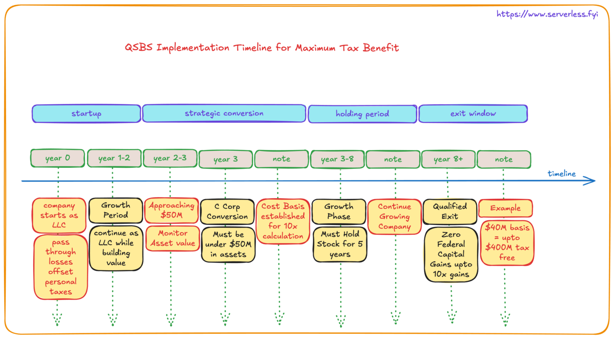

## Ultimate Guide to Tax-Free Exits

As an entrepreneur, the prospect of a lucrative exit is an exciting one. However, the tax implications of such an event can be daunting. That is, unless you know about the Qualified Small Business Stock (QSBS) tax break.

This post is primarily tailored for founders, offering insights into QSBS strategies, but early employees and investors will also find valuable information to help them maximize their benefits. Be sure to check out the previous blog for an introduction to QSBS and its core concepts. **[Unlocking Tax Savings with Qualified Small Business Stock (QSBS)](/p/unlocking-tax-savings-with-qualified-small-business-stock-qsbs/)******

QSBS is a provision in the tax code that allows founders to pay little to no taxes on a portion of their company's sale proceeds. The specifics are as follows:

- QSBS exempts up to $10 million (or 10 times your original investment, whichever is greater) from federal capital gains taxes when you sell your company's stock.
- To qualify, your company must have less than $50 million in assets when you acquire the QSBS.
- The company must also be a C-corporation, not an LLC or other pass-through entity.

Here's where things get interesting. Some founders have found a way to maximize the QSBS benefits by first starting their company as an LLC, and then converting to a C-corp right before their big exit.

The strategy goes like this:

1. Launch your company as an LLC while it's in the early, money-losing stages. This allows you to offset your personal taxes with the LLC's losses.
2. Once the company becomes profitable and approaches the $50 million asset cap, convert it to a C-corporation.
3. When you eventually sell the company, you can apply the QSBS exemption to up to 10 times the company's value at the time of the C-corp conversion - which could be well over $400 million.

This maneuver is completely legal, though it does come with some caveats:

1. The $10 million (or 10x basis) QSBS exemption only applies to the value of the company at the time of the C-corp conversion, not the full sale price.
2. The five-year holding period for QSBS only begins once the company becomes a C-corp, so you'll need to wait at least that long before selling.
3. You have to be extremely careful not to exceed the $50 million asset cap before the conversion.

While this tax strategy is undoubtedly complex, it demonstrates the power of careful tax planning for founders. By understanding the nuances of the tax code, you can potentially save yourself hundreds of millions in taxes when you eventually sell your company.

Of course, it's always best to consult with a qualified tax professional before attempting any major tax maneuvers. But for founders looking to maximize their exit proceeds, the QSBS loophole is certainly worth exploring.

## Understanding the QSBS Advantage

QSBS is one of the most powerful tax benefits available to entrepreneurs. It allows founders to potentially pay zero federal capital gains taxes on up to $10 million or 10 times their original investment basis, whichever is greater. This means with proper planning, you could walk away from your exit with hundreds of millions in tax-free gains.

## The Strategic Founder's Playbook

Here's how forward-thinking founders are maximizing this opportunity:

1. Initial LLC Structure (Years 0-2)

   - Start your company as an LLC
   - Use early-stage losses to offset your personal income taxes
   - Build value while maintaining pass-through tax benefits

2. Strategic Conversion Timing (Year 2-3)

   - Monitor your company's asset value carefully
   - Convert to a C-corporation before reaching $50 million in assets
   - Document your basis value at conversion (this becomes crucial later)

3. Growth and Holding Period (Years 3-8)

   - Continue growing your company
   - Maintain qualified business status
   - Hold the stock for at least 5 years post-conversion

4. Tax-Free Exit (Year 8+)

   - Sell your company
   - Pay zero federal capital gains taxes on up to 10x your basis
   - Example: $40M basis = up to $400M tax-free

### Key Considerations for Success

1. Scale Matters

   - The strategy works best for companies aiming for significant exits
   - Your initial basis needs to be substantial to maximize the 10x benefit

2. Timing is Everything

   - The 5-year holding period starts only after C-corp conversion
   - Converting too early or too late can limit your benefits

3. Asset Cap Awareness

   - Staying under the $50M asset cap before conversion is crucial
   - Careful monitoring and timing are essential

### Expert Tips for Implementation

1. Document Everything

   - Keep detailed records of your company's value at conversion
   - Maintain proof of qualification throughout the holding period

2. Professional Guidance

   - Work with tax professionals who understand QSBS
   - Regular consultations ensure you maintain qualification

3. Strategic Planning

   - Build your exit timeline around the 5-year holding requirement
   - Consider future funding rounds when planning your conversion

### The Power of Preparation

While this strategy wasn't always intentionally planned by founders, those who understand it early can maximize their benefits. The key is combining careful planning with patience – the five-year holding period might seem long, but the potential tax savings make it well worth the wait.

Remember: This strategy isn't just about saving money – it's about maximizing the value you've created through years of hard work and innovation. With proper planning and execution, QSBS can help you retain more of what you've earned, providing greater resources for your next venture or personal goals.

### The Bottom Line

QSBS represents one of the most significant tax advantages available to entrepreneurs. While the strategy requires careful planning and patience, the potential to save millions in taxes makes it an invaluable tool for founders planning their exit strategy. As with any tax strategy, consult with qualified tax professionals to ensure proper implementation and compliance.

In my next blog, I’ll explore how early employees can leverage QSBS to maximize their equity benefits and minimize taxes, unlocking more value from their stock options.

Disclaimer: Not tax advice - consult your advisors, but definitely worth exploring!
