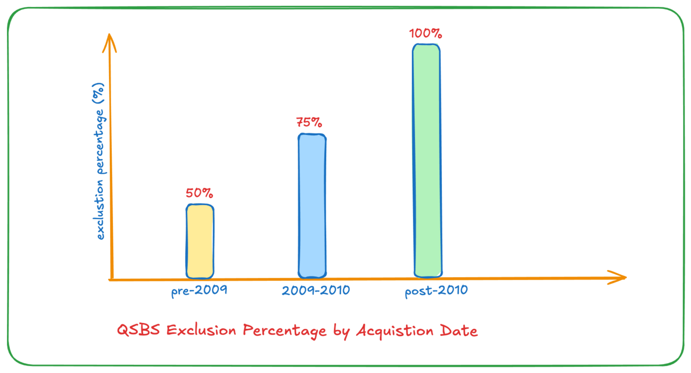

Qualified Small Business Stock (QSBS) is a tax incentive under Section 1202 of the U.S. tax code aimed at promoting investment in early-stage companies. By allowing for substantial capital gains tax exclusions, QSBS encourages investments in qualifying startups and small businesses. This benefit can significantly reduce or eliminate federal taxes on profits when the stock is sold, making QSBS a powerful tool for investors, founders, and employees alike.

This blog series is tailored for founders, investors, and early employees, offering insights into the unique tax advantages of Qualified Small Business Stock (QSBS) and how they can maximize its benefits.

- **Key Qualification Criteria:**

  - **Company Type**: Must be a C Corporation in a qualified industry (excluding fields like consulting and financial services).
  - **Gross Assets**: The company’s assets must be under $50 million at issuance.
  - **Original Issuance**: Stock must be acquired directly from the company, not via a secondary market.
  - **Holding Period**: Investors need to hold the stock for **at least five years** to claim the tax exclusion.

- **Capital Gains Exclusion Levels:**

  - **100% exclusion** for QSBS purchased after September 27, 2010.
  - **75% exclusion** for stock bought between February 18, 2009, and September 27, 2010.
  - **50% exclusion** for purchases before February 18, 2009.
  - **Exclusion Cap**: The greater of $10 million or **10 times the original investment**.

- **Benefits for Different Stakeholders:**

  - **For Investors**: Substantial tax savings on capital gains with up to a 100% exclusion; also, if sold within five years, gains can be deferred by reinvesting in other QSBS under Section 1045.
  - **For Founders**: QSBS can make the company more attractive to investors seeking tax benefits, enhancing fundraising efforts and encouraging long-term investment stability.
  - **For Early Employees**: Employees with QSBS stock options can also enjoy tax savings on any gain after five years, which can lead to substantial post-tax returns.

- **State-Specific Considerations**:

  - Some states, like California and Pennsylvania, do not conform to Section 1202, so investors may still owe state taxes even if they qualify for federal exclusions. Consulting with tax professionals is crucial to understand the complete tax impact.

**Conclusion:**\
QSBS provides a significant tax advantage for those investing in qualifying small businesses, making it a valuable tool for investors, founders, and employees. By understanding QSBS eligibility and benefits, stakeholders can better capitalize on this tax-saving opportunity while supporting innovation and growth in the small business ecosystem.

Stay tuned for future posts that will dive deeper into QSBS, providing specific insights and strategies tailored for founders, investors, and early employees to make the most of this powerful tax advantage.\
\
Disclaimer: Not tax advice - consult your advisors, but definitely worth exploring!
